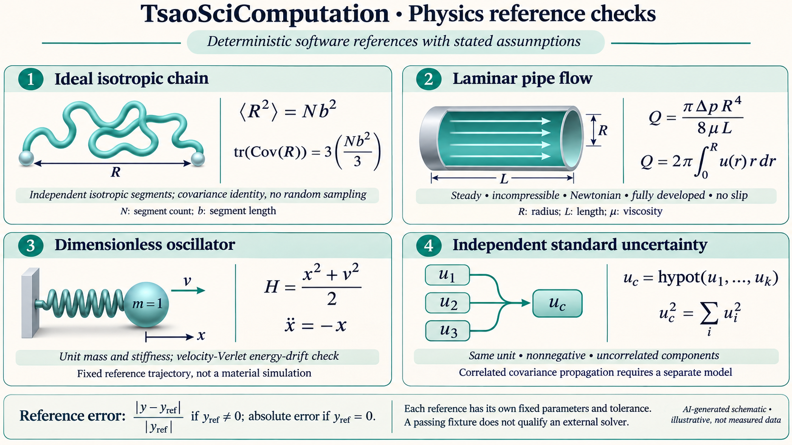
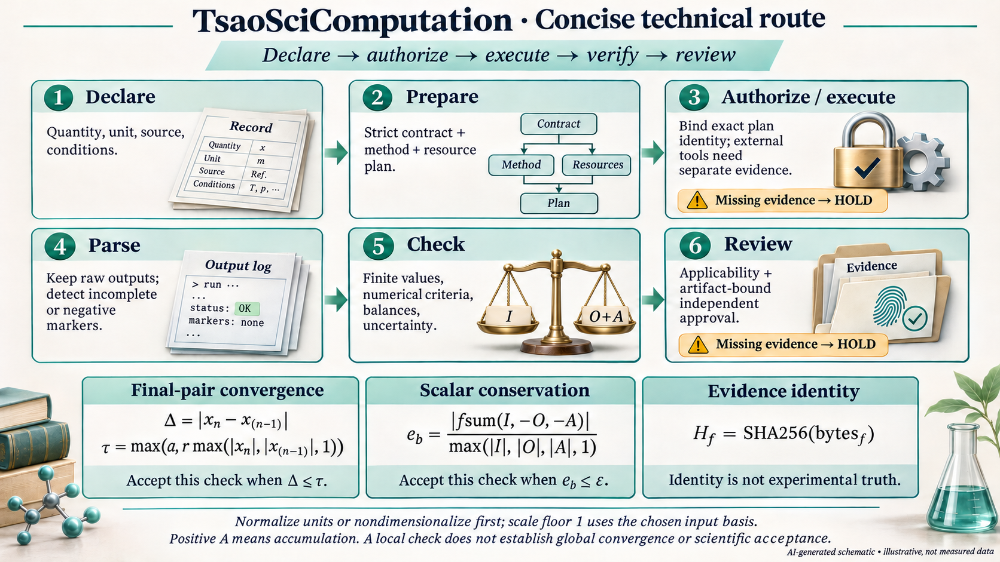
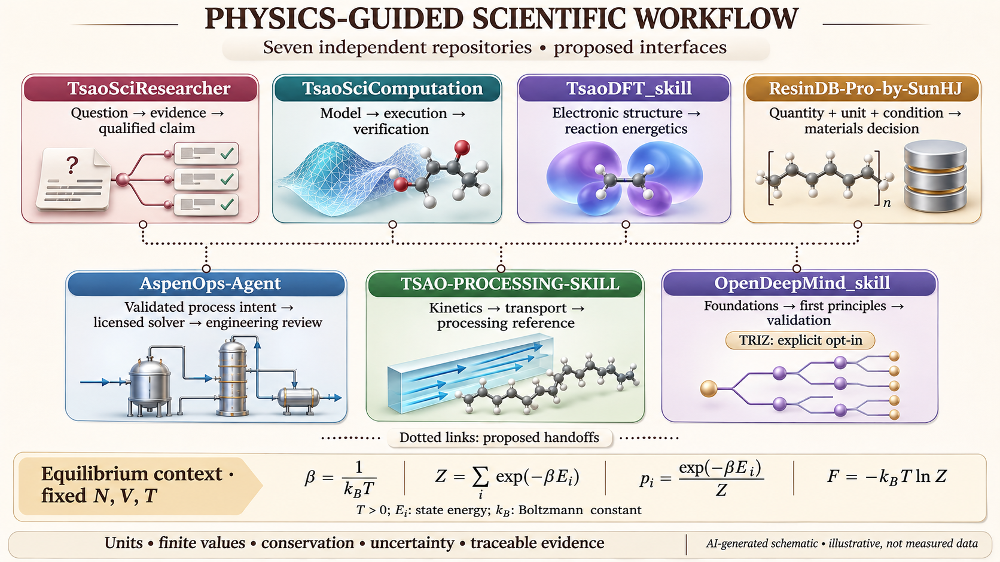

# TsaoSciComputation

**A scientific-computation control plane: turn a question into an explicit calculation contract, an authorized run and reviewable evidence.**

[简体中文](README.zh-CN.md) · [Root Skill](SKILL.md) · [Implementation guide](docs/scientific-contracts.md) · [Capabilities](capability-index/README.md) · [Acceptance](README_ACCEPTANCE.md)


*Figure 1. AI-generated illustrative architecture. The SVG is an accessibility wrapper containing one complete, unchanged generated PNG; it adds no drawn labels or geometry. The software prepares and checks evidence. External engines, licenses and scientific approval remain separate. [Image originals, exact prompts and provenance](docs/assets/ai-generated/README.md).*

## What runs here

The repository implements Python contracts, weighted keyword routing, local numerical checks, adapter-specific command preparation, controlled subprocess execution, output parsing and evidence governance. A routed method is a declared integration path. A completed process, a converged calculation and an accepted scientific claim have separate meanings.

| Task | Implemented entry point | Result and boundary |
|---|---|---|
| Turn a question into a plan | [Router](tsao_computation/routing/router.py), [calculation contract](tsao_computation/contracts/calculation.py) | Ranked keyword matches and explicit assumptions; the score is not a probability |
| Evaluate a local check | [Allowlisted invocations](tsao_computation/orchestration/planner.py) | Balance, convergence, uncertainty, fixed references, units or evidence-gate results |
| Prepare an external calculation | [Adapter protocols](tsao_computation/adapters/base.py) | GROMACS, Quantum ESPRESSO, ORCA or declared Python-driver arguments; other protocols need implementation |
| Run an authorized plan | [Execution runner](tsao_computation/execution/runner.py), [resources](tsao_computation/execution/resources.py) | Exact executable/input/environment identity, resource admission, timeout containment and partial batch evidence |
| Transfer an observable between scales | [ScientificQuantity](tsao_computation/scientific_quantity.py), [handoff](tsao_computation/contracts/handoff.py) | Units, conditions, reference state, uncertainty and immutable payload identity |
| Review a claim | [Acceptance gate](tsao_computation/validation/acceptance.py), [confidence](tsao_computation/validation/confidence.py) | Missing evidence and verified approval checks; no automatic scientific certification |

<!-- SUPER_SKILL_ORCHESTRATION:START -->
### Inventory is a routing contract

The current registries contain **164 capabilities, 27 external adapters and 20 workflows**. The orchestration layer declares **23 methods, 13 acceleration strategies and seven trusted local functions**. Inspect them with `list capabilities`, `list adapters`, `list workflows`, `list methods` and `list invocations`.

These counts describe registered contracts and integration paths. They do not mean that 27 numerical engines or 23 numerical algorithms are bundled. Generic service, container, scheduler and Skill targets are plan-only until an independently authorized implementation supplies execution evidence. See [orchestration documentation](docs/orchestration.md) and its [machine-readable audit](reports/ULTIMATE_COMPUTATION_SUPER_SKILL_AUDIT.json).
<!-- SUPER_SKILL_ORCHESTRATION:END -->

## Start with a local result

Python **3.10+** is required. The permanent CI matrix covers **Windows and Linux**, using Python 3.10 and 3.13. The package has no mandatory third-party runtime dependencies; validation and release tooling are installed separately from the hash-locked toolchain.

```bash
git clone https://github.com/SUNHAOJUN22/TsaoSciComputation.git
cd TsaoSciComputation
python -m venv .venv
```

Activate with `source .venv/bin/activate` on Linux or `.venv\Scripts\Activate.ps1` in Windows PowerShell, then run:

```bash
python -m pip install --require-hashes --only-binary=:all: -r requirements-ci.txt
python -m pip install --no-index --no-deps --no-build-isolation -e '.[validation,quality,security]'
python -m tsao_computation --version
python -m tsao_computation route "DFT to MD to CFD with explicit uncertainty and handoff validation"
python -m tsao_computation validate-contract examples/dft-md-cfd/contract.json --strict
python -m tsao_computation plan examples/dft-md-cfd/contract.json --strict
python -m tsao_computation invoke scientific-benchmarks --execute
```

The example contract is a **preparation template**. It contains methodological intentions and placeholders requiring real material, geometry, parameter and reference data. Strict validation checks the contract's completeness and structure; it does not establish the truth of those inputs. The final command executes eight repository-local analytical/invariant checks, not a third-party solver.

For a small, fully local Python calculation:

```python
from decimal import Decimal

from tsao_computation import ScientificQuantity
from tsao_computation.uncertainty import combine_independent
from tsao_computation.validation import balance_check, convergence_check

pressure = ScientificQuantity(
    value=Decimal("1.25"),
    unit="MPa",
    dimension=(-1, 1, -2, 0, 0, 0, 0),
    source_id="synthetic-readme-example",
    basis="REFERENCE",
    uncertainty=Decimal("0.05"),
)
converted = pressure.convert(unit="Pa", dimension=pressure.dimension)
assert converted.value == Decimal("1250000")
assert converted.uncertainty == Decimal("50000")
assert converted.source_quantity_digest == pressure.digest
assert balance_check(10.0, 7.0, 3.0, tolerance=1e-12)["passed"]
assert convergence_check([1.0, 1.0000001], absolute_tolerance=1e-6)["passed"]
assert combine_independent(3.0, 4.0, 0.0) == 5.0
```

Hash-locked dependencies and update policy are documented in [CI_DEPENDENCY_POLICY.md](docs/CI_DEPENDENCY_POLICY.md). A dependency hash proves file identity; vulnerability assessment is a separate release concern.

## Physics references, with their assumptions



*Figure 2. AI-generated illustration of implemented reference relations. The chain check evaluates a covariance identity without random sampling. The oscillator uses unit mass and stiffness. The uncertainty rule needs nonnegative, uncorrelated standard components in a common unit. These are not measured curves.*

The eight deterministic cases in [`scientific_benchmarks.py`](tsao_computation/validation/scientific_benchmarks.py) exercise a fixed set of analytic limits and numerical invariants:

| Reference | Relation | Assumptions and actual check |
|---|---|---|
| Steady conduction | $T(x)=T_L+(T_R-T_L)x/L$ | Constant properties, no source; finite-difference linear profile |
| Poiseuille flow | $Q=\pi\Delta pR^4/(8\mu L)$ | Steady, incompressible, Newtonian, fully developed no-slip pipe flow; radial quadrature |
| First-order CSTR | $C=C_{in}/(1+k\tau)$ | Ideal steady mixing; reaction-balance residual |
| First-order PFR | $C/C_0=e^{-k\tau}$ | Constant first-order rate; RK4 integration |
| Harmonic oscillator | $H=(x^2+v^2)/2$ | Dimensionless unit mass/stiffness, unit initial amplitude; velocity-Verlet drift |
| Ideal isotropic chain | $\langle R^2\rangle=Nb^2$ | Independent segments; trace of diagonal covariance, no sampled ensemble |
| Parallel plates | $\lvert\mathcal E\rvert=V/d$ | Linear potential without edge effects; central difference |
| Electrothermal balance | $VI=I^2R=G\Delta T$ | Steady lumped heat loss and constant coefficients |

$N$ is segment count, $b$ segment length, $\mu$ viscosity, $k$ a rate constant, $\tau$ residence time and $G$ thermal conductance. $R$ denotes pipe radius or resistance in the corresponding row. Inputs must use one consistent unit basis. Each fixture has its own fixed parameters and tolerance; a passing fixture does not validate an arbitrary material, discretization or external solver. [Parameters, tolerances and source mappings](docs/scientific-contracts.md#reference-fixtures).

**Statistical mechanics provides the interpretation, not an unimplemented solver claim.** At fixed $N,V,T>0$, $Z=\sum_i e^{-\beta E_i}$, $p_i=e^{-\beta E_i}/Z$ and $F=-k_BT\ln Z$, with $\beta=(k_BT)^{-1}$. Choosing the ensemble, energy model and observable is part of the scientific contract. The current chain reference is a closed-form limit; this package does not thereby implement a partition-function solver or establish adequate sampling. [Theory and implementation boundary](docs/scientific-contracts.md#statistical-mechanics-context), grounded in [Tong's statistical-physics notes](https://www.damtp.cam.ac.uk/user/tong/statphys/statmechhtml/S1.html).

## Technical route



*Figure 3. AI-generated technical route. Declare units and assumptions, prepare a strict plan, authorize its exact identity, preserve outputs, check the numerical and physical conditions, then obtain independent review. Missing execution or approval evidence remains a hold.*

The implemented scalar gates are compact, but their preconditions matter:

$$
\Delta=|x_n-x_{n-1}|,\quad
\tau=\max\!\left(a,r\max(|x_n|,|x_{n-1}|,1)\right),\quad
\Delta\le\tau,
$$

$$
e_b=\frac{|\operatorname{fsum}(I,-O,-A)|}{\max(|I|,|O|,|A|,1)}\le\varepsilon,
\qquad u_c=\operatorname{hypot}(u_1,\ldots,u_k).
$$

[`convergence_check`](tsao_computation/validation/numerical.py) checks finite admitted values and compares the **final pair**; it does not prove global convergence, grid independence or adequate mixing. The threshold uses `max`, not an additive rule. [`balance_check`](tsao_computation/validation/physical.py) uses **positive accumulation** $A$ in $I-O-A$ and common units/time basis. The numeric scale floor 1 requires an explicit unit basis or nondimensionalization. [`combine_independent`](tsao_computation/uncertainty/model.py) does not propagate covariance. The [implementation guide](docs/scientific-contracts.md) retains the full quantity, parser, handoff, resource, ledger and approval contracts.

## Choose an execution path

| Situation | Next step | Evidence needed |
|---|---|---|
| No solver installed | `route` → strict contract → `plan` | Observable, units, conditions, assumptions, parameter sources and validation plan |
| Small local calculation | Registered `invoke` or Python API | Admitted values, tolerance interpretation and result record |
| Existing GROMACS / QE / ORCA | Probe → engine input → exact-plan authorization → execution | Binary, input and environment identity; CPU/GPU/license claim |
| Python-module adapter | Select its own interpreter and declared `.py` driver | Module-location and interpreter identity; environments are not interchangeable |
| Multiscale study | Qualify upstream → immutable handoff → downstream | Units, reference state, uncertainty and overlapping applicability at each transfer |
| Proposed native or GPU acceleration | Profile → reference → equivalence → matched workload timing | Method/build/device identity, numerical tolerance and complete end-to-end cost |

[`Adapter.build_command()`](tsao_computation/adapters/base.py) builds `mdrun -s system.tpr` for GROMACS, `-i scf.in` for QE, `water.inp` for ORCA and `driver.py` for declared Python-module adapters. GROMACS preprocessing is separate. Other registry entries have no generic runnable command. New plans start with `execute_allowed=False`; local `invoke --execute` remains restricted to the seven registered functions. [Full execution and isolated-discovery contract](docs/scientific-contracts.md#execution-protocols).

The parser observes supplied text: positive completion and convergence markers are separate, negative markers veto their corresponding claim, and an earlier run's success cannot qualify a later truncated run. Preserve original output bytes alongside parser identity and the process record. Parser `validated` stays false. [Parser implementation](tsao_computation/adapters/base.py).

## Performance evidence and native boundaries

The [profiler](tsao_computation/performance/runner.py) records wall/process time, Python peak allocation, median, MAD, P95 and operation throughput for the stated workload. Static count admission precedes setup/operation, including every count in a materialized batch. Counts must be actual integers with the required minima; valid large integers are retained without a blanket $2^{53}$ cutoff. [Sample admission](tsao_computation/performance/model.py) rejects boolean, nonfinite, overflowing and nonzero-to-zero time conversions while preserving representable subnormals and signed zero.

**Measured throughput is checked after execution.** A finite operation count divided by a short measured time can still overflow; that result is rejected without rolling back the operation. Zero measured duration keeps the existing finite fallback and is not evidence of infinite speed. Count admission does not prevalidate arbitrary iterable side effects, callable behavior or all metadata. Defaults are seven repeats and one warmup; a qualified comparison still needs matched inputs, cache policy, environment and numerical equivalence. [Detailed performance contract](docs/scientific-contracts.md#performance-admission).

The optional [C++ native core](native/README.md) exposes a versioned C ABI and a Python `ctypes` bridge for CPU/OpenMP/optional CUDA Runtime discovery. Device discovery is not a scientific kernel benchmark. The pure-Python package remains usable without CUDA. [CMake commands and acceleration decision process](docs/scientific-contracts.md#native-build-and-qualification).

## Verification

```bash
python scripts/verify_all.py --profile all
python scripts/verify_native_core.py
python scripts/verify_all.py --profile benchmark
python -m pytest -q tests/test_performance_v9.py tests/test_performance_optimizations.py
python scripts/run_large_parser_regression.py
python scripts/final_acceptance_preflight.py --json
```

`all` executes the original quality, core and package profiles. It includes Ruff, formatting, Mypy, Bandit, repository security scanning, controlled mutation, the complete pytest suite, **95% total coverage**, critical-module coverage, scientific references, Schema/registry audits, generated-file checks, reproducible source/wheel builds, isolated installation, SBOMs and checksums. Native C ABI and benchmark/performance commands remain additional gates. The large-parser regression uses generated local text, not measured solver output.

<!-- CURRENT_MAIN_VERIFICATION:START -->
### Qualification belongs to an exact commit

| Metadata | Value |
|---|---|
| Version | 3.0.4 |

Use the permanent [CI workflow](.github/workflows/ci.yml) and original artifacts for the commit being deployed. Historical files under `reports/` are snapshots. Neither a previous green run nor focused tests qualify a newer commit. Six-hour regression requires original receipts binding the exact source SHA, elapsed successful test-process time and all failure evidence; this README does not predeclare its completion. External engines remain **EXTERNAL_HOLD** until their independent evidence is provided.
<!-- CURRENT_MAIN_VERIFICATION:END -->

## External approval contract

The [acceptance gate](tsao_computation/validation/acceptance.py) requires seven strict boolean evidence predicates: completed, parsed, converged, physically validated, uncertainty quantified, applicability confirmed and evidence bound. A valid artifact SHA-256 and a verified, time-bounded independent approval are additional requirements. The deployment supplies trusted keys; caller-written approval flags do not suffice. Handoff `checked` and `validated` also remain distinct. [Exact governance limits](docs/scientific-contracts.md#48-acceptance-is-an-evidence-gate).

Use `EXTERNAL_HOLD` when external execution, method-specific validation or independent approval is missing. The [bilingual acceptance guide](README_ACCEPTANCE.md) explains what the delivery preflight actually checks. Historical reports and green checks do not qualify a changed source tree.

## The seven-repository research route



*Figure 4. Shared AI-generated research roadmap. This repository provides computation contracts and evidence controls within the broader research route. The diagram describes intended handoffs; it does not prove that the seven repositories form an already executed pipeline. [Original generation receipt](docs/assets/ai-generated/manifest.json).*

## Maintenance and deeper documentation

Read the [bilingual implementation guide](docs/scientific-contracts.md), [architecture](docs/architecture.md), [scientific validation](docs/scientific-validation.md), [orchestration](docs/orchestration.md), [scenario examples](examples), [release policy](docs/release.md) and [third-party boundary](THIRD_PARTY.md). For a refused contract or numeric input, correct the source record and retain the failure. For a changed executable, input, unit conversion or model, rebuild the affected plan and evidence. Do not fill missing observations with zero or write an acceptance flag to substitute for review.

All four current figures are complete imagegen outputs; the first uses a compatibility wrapper. The **43 historical Scientific Research Console V13 SVGs** remain in the [historical visual atlas](assets/visuals/README.md) under its original [design and safety policy](assets/visuals/DESIGN_SYSTEM.md). Historical diagrams are text-linked or clearly archived; they are not represented as the new AI-generated artwork. The maintained source index below is a text-only index.

`main` is the sole authoritative long-lived branch. Windows and Linux are the supported delivery platforms. No commercial solver, license or private dataset is bundled. [MIT license](LICENSE) · [Citation metadata](CITATION.cff).

<!-- CURRENT_MAIN_ACCEPTANCE_V2:START -->
### Maintained source index

[Adapter and parser](tsao_computation/adapters/base.py) · [Execution record](tsao_computation/execution/runner.py) · [Convergence](tsao_computation/validation/numerical.py) · [Uncertainty](tsao_computation/uncertainty/model.py) · [Legacy localized architecture](docs/current-main/tsao-scicomputation-current-main-en.svg)

The equations and strategies above describe current code. Concept figures and historical artifacts are not execution attestations. Changed source requires fresh qualification.
<!-- CURRENT_MAIN_ACCEPTANCE_V2:END -->
