<div align="center">

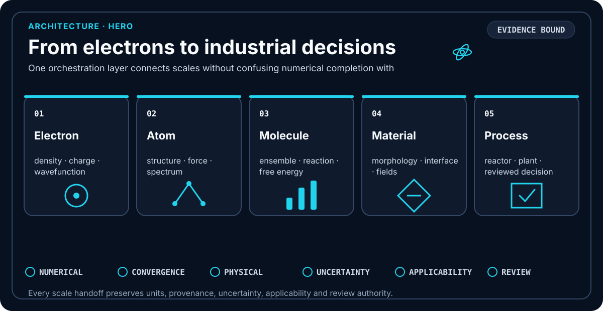

# TsaoSciComputation

**Evidence-governed scientific-computation orchestration from equations and solver identity to reproducible delivery.**

     

[中文说明](README.zh-CN.md) · [Root Skill](SKILL.md) · [Capabilities](capability-index/README.md) · [Visual atlas](assets/visuals/README.md) · [Validation](docs/scientific-validation.md) · [Architecture](docs/architecture.md) · [Delivery prompt](docs/autonomous-software-hardening-prompt.md)

</div>

<!-- LOCALIZED_VISION_EN:START -->
## Project vision: from governing equations to reproducible computation

<p align="center">
  
</p>

> The equations map to contract, execution-identity, convergence, uncertainty and acceptance modules. The figure does not claim that VASP, Gaussian, GROMACS, OpenFOAM or Aspen has run.

<!-- LOCALIZED_VISION_EN:END -->

## Delivery status

TsaoSciComputation is a deliverable software control plane with an explicit boundary between **repository qualification** and **external scientific execution**.

- **164 capabilities**, **27 external adapters**, **20 machine-readable workflows**, **23 methods**, **13 acceleration strategies** and **7 trusted local functions**;
- test counts and measured coverage are taken from the complete CI run for the exact commit being reviewed; the enforced total-coverage floor is **95.00%**;
- Ruff, Mypy, Bandit, repository security scanning, controlled mutation, Schema, Manifest, reproducible source/Wheel, isolated installation, SBOM and native C ABI checks remain the release gates;
- `main` is the sole authoritative branch;
- real third-party solver correctness remains **`EXTERNAL_HOLD`** until binaries, licenses, fixed inputs, hardware fingerprints, reference values and scientific tolerances are supplied.

No exit code, version string, GPU visibility variable or benchmark microsecond is promoted into a scientific claim by itself.

## What the repository is

TsaoSciComputation turns a scientific question into a governed calculation program:

```text
question → contract → method/scale route → preflight → bounded execution
         → parse → convergence → numerical/physical validation
         → uncertainty/applicability → accept, reject or hold
```

It is a **control plane and qualification framework**, not a bundled DFT, MD, CFD, FEM or process simulator. Python owns contracts, routing, policy, provenance and acceptance. A source-only C++20/OpenMP layer exposes a versioned C ABI for measured software hotspots. External engines remain separately installed, licensed and qualified.

### Claim boundary

The repository does **not** claim:

- fabricated VASP, Quantum ESPRESSO, Gaussian, GROMACS, OpenFOAM, Aspen or commercial-solver execution;
- GPU/MPI numerical equivalence without a trusted CPU reference;
- production speedup from orchestration-only benchmarks;
- convergence or physical validity from process completion;
- a boolean value as a valid scientific real scalar.

## Quick start

```bash
git clone https://github.com/SUNHAOJUN22/TsaoSciComputation.git
cd TsaoSciComputation
python -m pip install --require-hashes --only-binary=:all: -r requirements-ci.txt
python -m pip install --no-index --no-deps --no-build-isolation -e '.[validation,quality,security]'

python -m tsao_computation route \
  "Plan a DFT-to-MD interface study with explicit uncertainty gates"
python -m tsao_computation validate-contract \
  templates/calculation-contract.json --strict
python -m tsao_computation probe

python scripts/verify_all.py --profile all
python scripts/verify_native_core.py
```

[`requirements-ci.txt`](requirements-ci.txt) fixes the full validation toolchain with distribution SHA-256 hashes and platform/Python markers. CI installs those third-party wheels first, then installs this checked-out project with external dependency resolution disabled. See the bilingual [CI dependency policy](docs/CI_DEPENDENCY_POLICY.md) for controlled updates and the remaining repository-governance findings. Hash verification establishes file identity; the scheduled vulnerability audit remains a separate check.

External execution is intentionally separate:

```bash
python -m tsao_computation probe-solver gromacs \
  --output .tsao-computation/gromacs-capability-evidence.json

python -m tsao_computation plan-acceleration gromacs \
  --solver-evidence .tsao-computation/gromacs-capability-evidence.json \
  --require-solver-evidence
```

A complete fingerprint can reach `version-probed-unqualified`; it still does not prove numerical correctness, convergence, license availability or accelerator equivalence.

<!-- SUPER_SKILL_ORCHESTRATION:START -->
## Capability and execution model

The repository exposes **164 capabilities**, **23 computation methods**, **9 invocation types**, **7 trusted local functions**, **27 external adapters**, **20 workflows**, **13 acceleration strategies** and a **9-stage orchestration plan**.

| Invocation mode | Default behavior |
|---|---|
| Registered trusted local function | Validate payload, execute a bounded implementation, and hash request/result evidence |
| External solver or adapter | Probe identity and build a command plan; execution requires separate authorization |
| Python module, CLI, API, container, scheduler or Skill | Produce a declarative handoff until runtime, identity and evidence conditions are satisfied |

Execution is fail-closed. Relative executables and inputs resolve from normalized `CommandPlan.cwd`. Bare command names resolve once against a sanitized immutable `PATH`, become absolute paths, are hashed, and are rebound immediately before launch. The authorized normalized working directory is the directory passed to the process runner.

`ExternalExecutionCapability.is_verified()` and `SignedExecutionReceipt.is_verified()` accept only the literal Boolean `True` from the configured signature verifier; truthy strings, status objects and numbers are rejected. Receipt verification also requires the caller's expected request and capability IDs and the executor ID from the already-verified capability to match the signed receipt before invoking the verifier. Omitting the expected executor fails closed, preventing a trusted but differently authorized executor from supplying a receipt for the same request and capability. The verifier still owns cryptographic and executor-trust policy; signature verification does not establish scientific correctness or acceptance.

Scalar-sensitive trusted callables are also fail-closed: booleans never acquire scientific meaning through Python's `bool ⊂ int` implementation detail, and non-finite failure sentinels are converted to JSON-safe structured evidence before hashing.
<!-- SUPER_SKILL_ORCHESTRATION:END -->

## Architecture at a glance

<table>
<tr>
<td width="50%">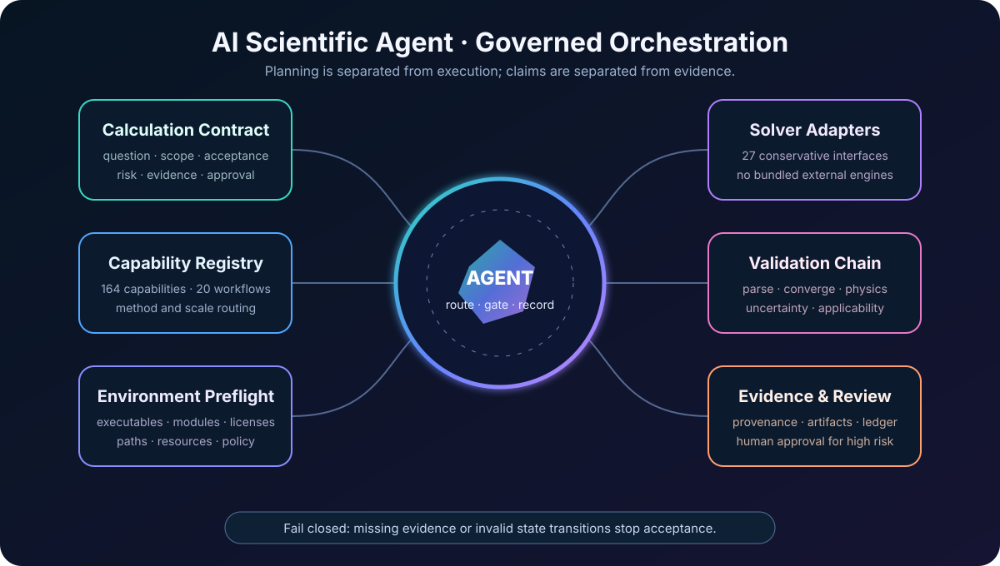</td>
<td width="50%">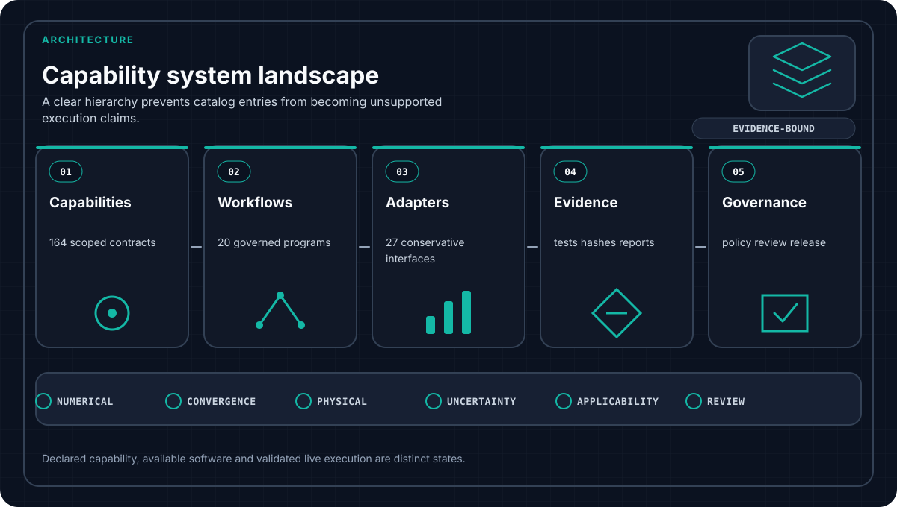</td>
</tr>
<tr>
<td align="center"><strong>Governed scientific agent</strong></td>
<td align="center"><strong>Contract-based capability system</strong></td>
</tr>
</table>

| Layer | Responsibility | Acceptance boundary |
|---|---|---|
| Python control plane | contracts, routing, evidence, provenance, policy, parsers, UQ and decisions | deterministic repository qualification |
| Native interoperability plane | C++20/OpenMP discovery and measured kernels through a versioned C ABI | ABI, build, CTest and equivalence gates |
| External solver plane | DFT/MD/CFD/FEM/process execution | real installation, license, fixed input, reference and tolerance evidence |

## Mathematical operating model

The equations in this section describe the Python implementations linked below. The external DFT, MD, CFD, FEM and process equations shown in the vision artwork express the intended application domains; the repository orchestrates those engines rather than solving their governing equations itself.

### 1. Explicit calculation contracts

[`CalculationContract`](tsao_computation/contracts/calculation.py) records the question, system, conditions and observables together with assumptions, model objects, scales, methods, boundary and initial conditions, parameter sources, convergence and validation plans, uncertainties, resources, expected artifacts, review nodes and acceptance criteria. Its structural preflight requires all declared preflight fields to be populated:

$$
G_{\mathrm{preflight}}=\bigwedge_{f\in F_{\mathrm{required}}}\operatorname{present}(f).
$$

This is a completeness check. A nonempty assumption or validation plan still needs domain review. The planning layer does not convert an empirical closure into a physical law or supply missing solver data.

### 2. Quantities bind values, units and dimensions

[`ScientificQuantity`](tsao_computation/scientific_quantity.py) binds a finite Decimal value, controlled unit, seven-integer dimension vector, source identifier, basis and optional nonnegative uncertainty. The dimension order is **length, mass, time, temperature, amount, electric current, luminous intensity**:

$$
\mathbf d=(d_L,d_M,d_T,d_{\Theta},d_N,d_I,d_J),\qquad
[\mathrm{Pa}]=L^{-1}MT^{-2},\qquad [\mathrm{Pa\,s}]=L^{-1}MT^{-1}.
$$

The versioned [unit registry](tsao_computation/quantity_units.py) determines dimension and conversion coefficients together. Energy (`J`, `eV`, `hartree`) and molar energy (`J/mol`, `kJ/mol`) have different dimensions. Changing an energy into a molar energy requires an explicit physical amount or particle-count model, not a unit relabel.

For affine canonical conversions $x_c=a_s(x_s+b_s)$ and $x_c=a_t(x_t+b_t)$, the code applies

$$
x_t=\frac{a_s(x_s+b_s)}{a_t}-b_t,\qquad
u_t=\left|\frac{a_s}{a_t}\right|u_s.
$$

Offsets do not apply to standard uncertainty. Rational Fahrenheit coefficients preserve the distinction between absolute temperature and temperature intervals. For example, $32\,{}^\circ\mathrm F=273.15\,\mathrm K$ and an uncertainty of $1.8\,{}^\circ\mathrm F$ becomes $1\,\mathrm K$. Absolute values at or below zero kelvin are rejected; negative temperature differences remain valid. Unknown units, contradictory supplied conversion factors, booleans, nonfinite values and nonzero Decimal exponents outside $[-308,308]$ are rejected.

```python
from decimal import Decimal
from tsao_computation.scientific_quantity import ScientificQuantity

pressure = ScientificQuantity(
    value=Decimal("1.25"), unit="MPa",
    dimension=(-1, 1, -2, 0, 0, 0, 0),
    source_id="instrument:pressure-01", uncertainty=Decimal("0.05"),
)
pressure_pa = pressure.convert(unit="Pa", dimension=pressure.dimension)
assert pressure_pa.value == Decimal("1250000")
assert pressure_pa.uncertainty == Decimal("50000")
assert pressure_pa.source_quantity_digest == pressure.digest
```

The converted record retains a parent digest and `DERIVED` basis. `from_mapping()` revalidates units, dimensions and registry metadata instead of trusting deserialized labels.

### 3. Finite scalars and the implemented convergence rule

[`convergence_check`](tsao_computation/validation/numerical.py) consumes the entire supplied sequence, rejects boolean, nonfinite and nonzero-to-zero underflowed observations, and compares the **last two** finite values. Its actual threshold is a maximum, not a sum:

$$
\Delta=|x_n-x_{n-1}|,\quad s=\max(|x_n|,|x_{n-1}|,1),\quad
\tau=\max(\tau_{\mathrm{abs}},\tau_{\mathrm{rel}}s),\quad
G_{\mathrm{conv}}=(\Delta\leq\tau).
$$

Both tolerances must be finite, nonnegative and representable without nonzero-to-zero underflow. Numeric scalar strings, `Decimal` and `Fraction` inputs follow the same conversion guard; genuine signed zero and representable subnormal floats remain valid. A top-level `str`, `bytes`, `bytearray` or `memoryview` is rejected as an observation sequence so its characters or byte values cannot be mistaken for separate measurements. Fewer than two values or an invalid observation yields failure. This local test does not establish a convergence rate, stationarity, mesh independence, nonlinear residual satisfaction or a global optimum. Record those additional criteria in the calculation contract and supply their evidence separately. The trusted invocation layer converts invalid floating-point sentinels into JSON-safe failure evidence before hashing.

JSON files supplied to CLI commands and read through the strict provenance/evidence boundary are checked before conversion to binary floats. A nonzero decimal that would become `0.0` is rejected; exact zero and representable subnormals remain valid.

### 4. Conservation uses an explicit accumulation sign

[`balance_check`](tsao_computation/validation/physical.py) implements a scalar balance using common units and a common time basis:

$$
r=I-O-A,\qquad
r_{\mathrm{norm}}=\frac{|r|}{\max(|I|,|O|,|A|,1)},\qquad
G_{\mathrm{balance}}=(r_{\mathrm{norm}}\leq\varepsilon).
$$

Here $A$ is accumulation, positive when material or energy is stored in the control volume. Inputs, outputs, accumulation and tolerance use the same finite, nonzero-underflow guard as convergence; tolerance is nonnegative. A nonzero residual whose normalization would round to zero is rejected instead of reporting an exact balance. The function does not infer chemistry, sum streams with different physical bases or convert mass into molar flow. A residual with incompatible units must be rejected before this scalar check.

### 5. Independent uncertainty and its limits

[`combine_independent`](tsao_computation/uncertainty/model.py) uses `math.hypot` for a stable root-sum-of-squares calculation:

$$
u_c=\sqrt{u_{\mathrm{stat}}^2+u_{\mathrm{model}}^2+u_{\mathrm{num}}^2},\qquad u_i\geq0.
$$

All components must already use the same unit and represent compatible standard uncertainties. The implementation rejects nonfinite components and an overflowing combined result. It does not estimate correlations. When correlations matter, the required mathematical model is

$$
u_y^2=\mathbf J\,\boldsymbol\Sigma\,\mathbf J^{\mathsf T},
$$

where $\mathbf J$ is the sensitivity row and $\boldsymbol\Sigma$ the input covariance matrix. That covariance propagation is a model-specific extension, not a computation performed by `combine_independent`. Preserve sampling, model-form and numerical uncertainty separately until their interpretation is established.

### 6. Cross-model handoff is a numerical and evidence contract

[`HandoffRecord`](tsao_computation/contracts/handoff.py) binds source/receiving model, observable, value, unit, conditions, reference state, statistical/model uncertainty, applicability and transformation:

$$
H_{\mathrm{handoff}}=\operatorname{SHA256}\!\left(\operatorname{CanonicalJSON}
(M_s,M_t,q,x,u,C,R,U_s,U_m,\Omega,T)\right).
$$

Values must be finite numeric scalars or nonempty rectangular arrays, up to six nesting levels and 100,000 scalar cells. Arbitrary distribution dictionaries are not silently interpreted as numbers. Uncertainty magnitudes are nonnegative and must have a matching array shape or be an explicitly supplied scalar bound. A structured uncertainty also requires a unit with the same physical dimension; its own unit is preserved and must be converted before combining uncertainties.

Nested conditions, values, uncertainty and evidence are copied and frozen. Mutating the caller's original list cannot change an admitted record or digest. `to_dict()` and `from_mapping()` provide a serialization path that rechecks the contract. `checked` describes software contract checks; `validated` additionally requires external trusted approval over this exact scientific payload. The digest excludes the review decision and signatures to avoid circular signing. A valid signature for another value, condition or transformation is rejected.

### 7. Parser observations remain separate from execution and science

[`Adapter.parse`](tsao_computation/adapters/base.py) reports explicit textual completion and convergence, parser version, detected engine-version text (or `unknown`), SHA-256 of the supplied UTF-8 text and the active run offset. A recognized later run start prevents an earlier run's success from qualifying a truncated later run. Negative observations override positive ones:

$$
G_{\mathrm{text,complete}}=P_{\mathrm{complete}}\land\neg N_{\mathrm{complete}},\qquad
G_{\mathrm{text,converged}}=G_{\mathrm{text,complete}}\land P_{\mathrm{conv}}\land\neg N_{\mathrm{conv}}.
$$

Examples such as `SCF not yet converged`, `not normal termination` and `converged=false` stay false. Generic or engine-specific success markers describe **text status only**. The parser does not independently prove who produced a log, verify executable bytes or validate a scientific model; `validated` stays false. Preserve the original output bytes and execution record separately, especially if decoding changes the text.

### 8. Accepted states share one verification gate

[`acceptance_gate`](tsao_computation/validation/acceptance.py), [`ScientificStateMachine`](tsao_computation/state/machine.py) and [`assess_confidence`](tsao_computation/validation/confidence.py) use the same artifact-bound acceptance rule:

$$
G_{\mathrm{accept}}=
\left(\bigwedge_{j=1}^{7} b_j\right)
\land\operatorname{ValidDigest}(H)
\land\operatorname{Verify}_{K_{\mathrm{trusted}}}(\sigma,H,\mathrm{scope},\mathrm{role},t).
$$

The seven flags cover completion, parsing, numerical convergence, physical validation, quantified uncertainty, confirmed applicability and bound evidence. They are declared evidence summaries; the signature and external reviewer establish the review boundary. Approved artifacts require scope `scientific-result-acceptance`, role `independent-domain-reviewer`, distinct requester/approver identifiers and a valid time window. Trust keys come from the calling environment, never from the result payload.

C0–C3 classify progressively richer declared evidence. C4 requires verified scientific acceptance. C5 also requires separate signed `engineering-decision`, `safety-review` and `independent-reproduction` attestations with their required roles, all bound to the same artifact and explicit decision scope. Strings such as “reviewed by an expert,” caller boolean flags or embedded keys cannot raise a record to C4/C5.

Direct construction of an accepted state is rejected. Transitioning from physical validation to scientific acceptance requires the same verified record, and the transition evidence must equal its artifact digest. State and recorded events are immutable through the public interface. A complete state sequence with invented evidence strings cannot authorize acceptance.

The separately exported compatibility APIs `acceptance_is_verified()` and `require_verified_acceptance()` delegate signature verification to a caller-provided trusted verifier. Only its explicit Boolean `True` result authorizes the envelope; `False`, strings such as `"false"`, numeric status codes, containers, custom truthy objects and verifier exceptions are rejected. The hook does not interpret an object's `__bool__()` method, perform cryptographic verification itself, or grant C4/C5 classification. The configured verifier must validate the canonical message, signature and reviewer against the deployment's actual trust policy.

### 9. Provenance and resource claims remain explicit

[`hashing.py`](tsao_computation/hashing.py) canonicalizes JSON with sorted keys, compact separators and finite numbers; it hashes file bytes in bounded chunks. Execution bindings include normalized command/cwd, executable identity, input identities and environment. The authorization digest is a hash of that structured binding, not an ambiguous concatenation of display strings:

$$
H_{\mathrm{authorization}}=\operatorname{SHA256}(\operatorname{CanonicalJSON}(B)),\qquad
H_{\mathrm{file}}=\operatorname{SHA256}(\mathrm{bytes}_{\mathrm{file}}).
$$

Batch execution keeps partial runtime evidence when one process times out or cannot be started: completed records remain available, `record_indices` maps them to the requested plans, and `failures`/`failed_indices` identify the tasks without a completed process record. Security and contract violations still raise; callers should not infer scientific acceptance from `completed`.

Resource admission requires compatible CPU, GPU and license claims. For additive resources,

$$
\sum_{p\in\mathcal P_{\mathrm{active}}}r_{p,j}\leq c_j,
$$

with additional exclusivity and device-visibility checks for GPUs. These are local scheduling and evidence controls. Solver performance, CPU/GPU equivalence and model accuracy need separately measured workloads and reference results.

Regression coverage for the repaired production entrances is in [`tests/test_acceptance_repair.py`](tests/test_acceptance_repair.py); the original acceptance, numerical, resource-broker and execution suites remain active.

## Qualification and delivery diagrams

The following AI-assisted information designs are deterministic repository-owned SVG sources. They explain code and qualification logic; they are not fabricated solver output.

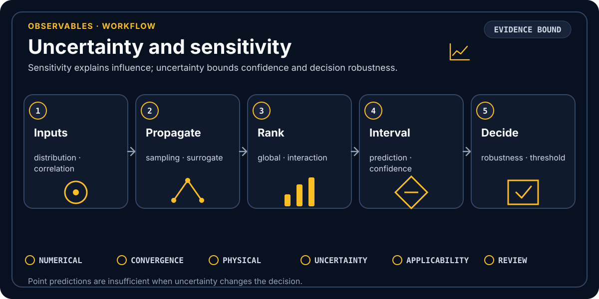
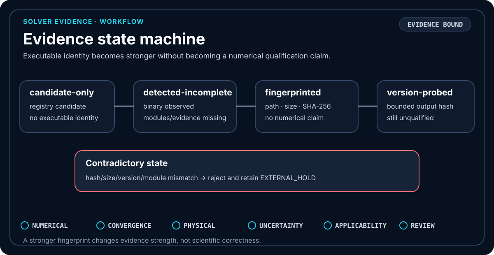
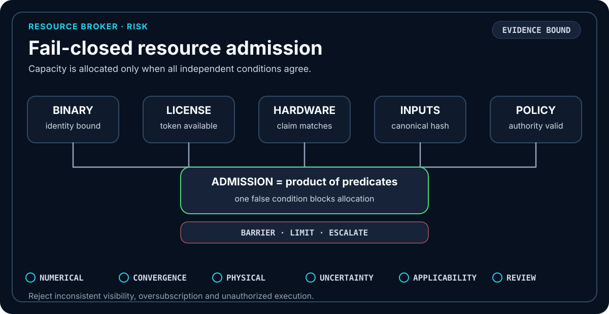
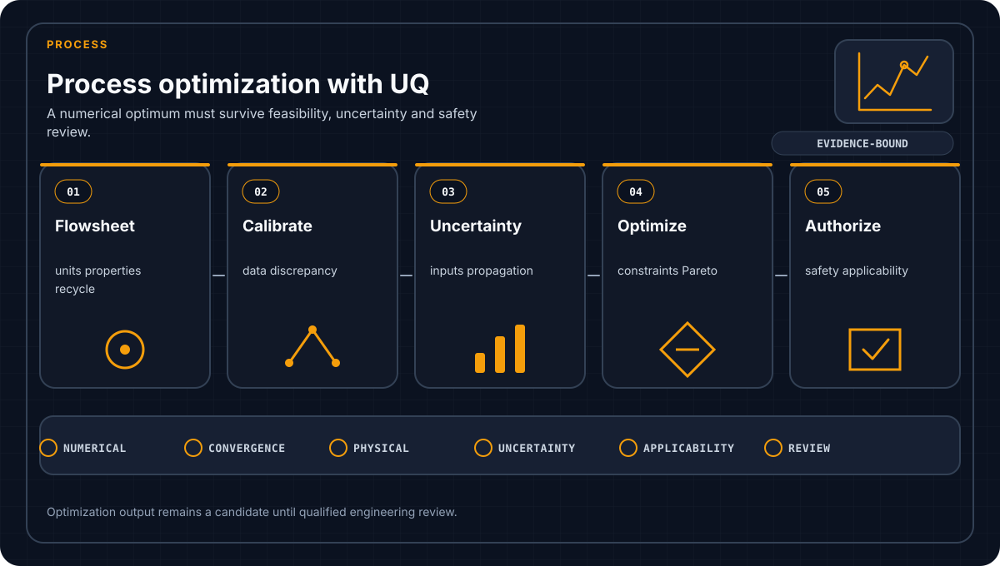

<!-- V13_VISUAL_SYSTEM:START -->
The repository contains **43 self-contained SVGs** using **Scientific Research Console V13**. The root READMEs showcase **12 representative diagrams**; the complete inventory is in [`assets/visuals/README.md`](assets/visuals/README.md), with design and trust rules in [`assets/visuals/DESIGN_SYSTEM.md`](assets/visuals/DESIGN_SYSTEM.md).
<!-- V13_VISUAL_SYSTEM:END -->

## Usage strategies

### Implemented execution protocols

The 27 adapter entries describe routing and environment capabilities; executable presence alone does not make every adapter runnable. [`Adapter.build_command()`](tsao_computation/adapters/base.py) currently implements these input protocols:

| Adapter path | Prepared argv after the resolved executable | Required input |
|---|---|---|
| GROMACS | `mdrun -s system.tpr` | A preprocessed `.tpr` file; preprocessing is a separate operation |
| Quantum ESPRESSO | `-i scf.in` | A PWscf input deck |
| ORCA | `water.inp` | An ORCA input file |
| Declared Python-module adapter | `driver.py` | A `.py` driver plus the declared modules in that interpreter |
| Other adapter entries | No runnable generic argv | Engine-specific protocol implementation and qualification required |

The GROMACS and QE argument forms follow the [GROMACS mdrun reference](https://manual.gromacs.org/current/onlinehelp/gmx-mdrun.html) and [QE input-file guidance](https://www.quantum-espresso.org/Doc/pw_user_guide/node21.html). Every constructed plan still has `execute_allowed=False`; authorization binds executable/input bytes, cwd and environment before launch. A stub executable can verify argument shape in tests, but it cannot certify the external solver.

### Migrate existing evidence safely

Older records that supplied unknown unit labels, conflicting dimensions, arbitrary conversion factors, negative uncertainty, free-form approval strings or an accepted-state constructor now fail validation. Rebuild them from their actual source data; do not fill missing evidence with placeholder approvals. Ordinary handoffs without external review use `checked` or `unvalidated`. A `validated` handoff needs a signed acceptance record bound to `handoff.digest` and consumer-provisioned trust keys.

```python
from tsao_computation.validation import assess_confidence
from tsao_computation.state import ScientificStateMachine

# record comes from a qualified evidence package; trusted_keys is provisioned
# by the receiving environment, never extracted from record itself.
assessment = assess_confidence(record, trusted_approval_keys=trusted_keys)
machine = ScientificStateMachine("physically-validated")
machine.transition(
    "scientifically-accepted", evidence=record["artifact_sha256"],
    acceptance_record=record, trusted_approval_keys=trusted_keys,
)
```

Without the external trust context, the confidence interface remains below C4. C5 additionally needs separately signed decision, safety and reproduction scopes. HMAC verification protects integrity within the configured trust domain; deployments remain responsible for reviewer identity, key protection, revocation and persistent replay policy.

### Strategy A — planning without solver access

Use routing, contract validation and capability inspection to produce a defensible calculation plan. Keep it plan-only or `EXTERNAL_HOLD`; do not invent runtime evidence.

### Strategy B — strict scalar ingestion

Validate every observation, tolerance and uncertainty component before calculation. Reject booleans, NaN and infinity. Preserve failure as JSON-safe structured evidence so request/result hashes remain deterministic.

### Strategy C — external solver onboarding

```text
qualification-bundle/
├── solver-identity.json        # path, size, SHA-256, bounded version output
├── environment.json            # OS, runtime, libraries, scheduler, devices
├── inputs/                     # fixed canonical inputs
├── references/                 # trusted CPU or analytical references
├── tolerances.json             # observable-specific limits
├── license-evidence.json       # availability and authorization boundary
└── provenance.json             # bundle hash and review authority
```

Qualify identity, CPU correctness, GPU/MPI equivalence and performance in that order.

### Strategy D — edge deployment

Pre-package registries and Schemas; default to CPU-only unless the accelerator is fingerprinted; cap workers and memory; transfer only hash-bound evidence bundles to larger solver hosts.

### Strategy E — shared HPC deployment

Map immutable claims to scheduler CPU/GPU/license requests; separate scratch, checkpoint and evidence directories; bind scheduler metadata to provenance; retry only classified transient failures.

### Strategy F — acceleration engineering

1. inventory and profile a real workload;
2. distinguish orchestration from numerical-kernel cost;
3. prefer solver-native parallelism and mature libraries;
4. establish a trusted CPU reference;
5. prove GPU/MPI equivalence with declared observables and tolerances;
6. measure same-problem performance with uncertainty.

### Strategy G — acceptance and audit

Require a reference, tolerance, evidence identity and approving authority for every claim. A successful process without those items remains unaccepted.

## Multiscale scientific visual map

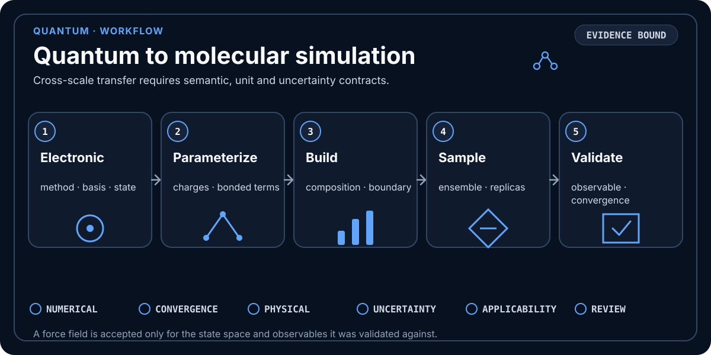
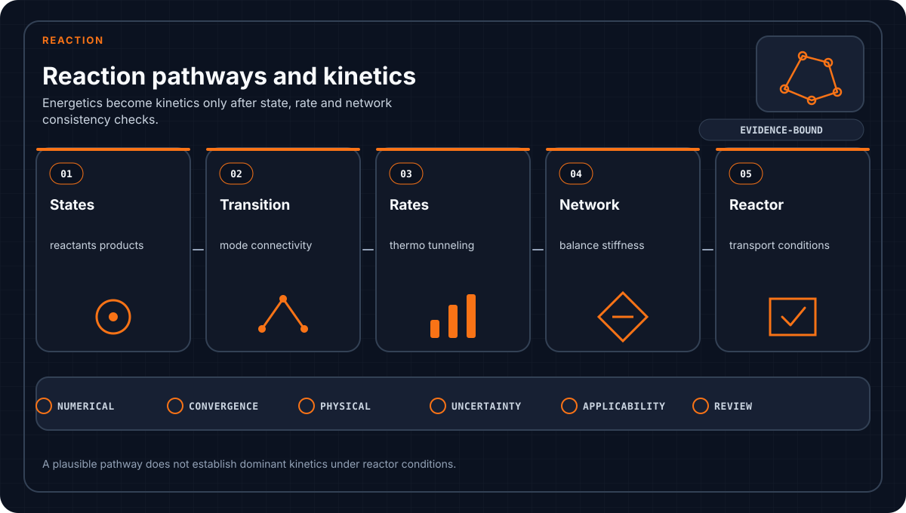
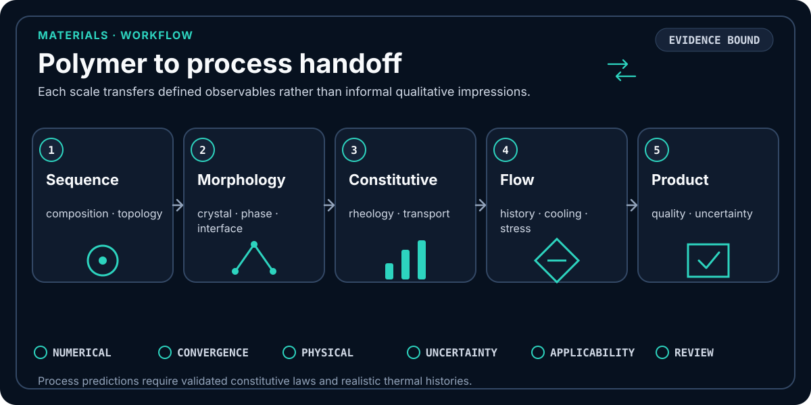
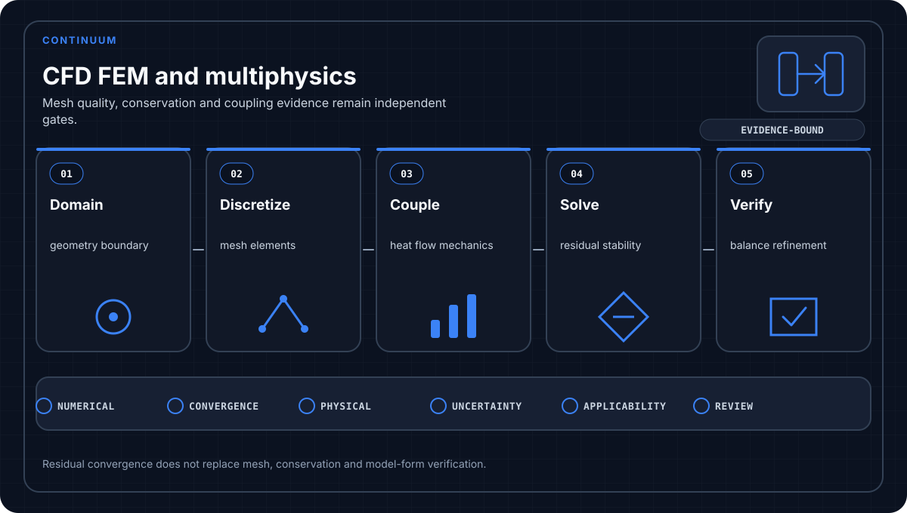

## Acceleration and native interoperability

Python remains the control plane. A hotspot crosses into C++/OpenMP/CUDA only after profiling demonstrates material value and equivalence can be tested independently.

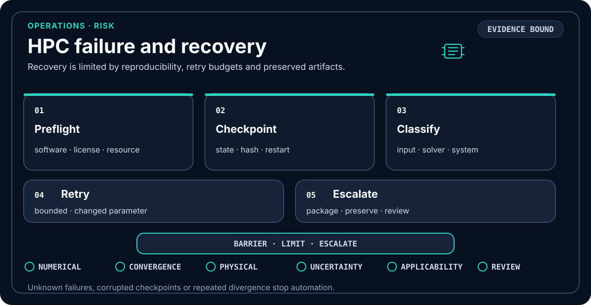

```bash
python scripts/build_acceleration_audits.py
python -m tsao_computation audit-acceleration \
  --root . --scope production --limit 50 --min-score 40 \
  --output reports/ACCELERATION_OPPORTUNITIES_PRODUCTION_V4.json
python -m tsao_computation profile-performance \
  --workload routing-hot --workload acceleration-plan \
  --repeats 7 --warmups 1 \
  --output .tsao-computation/performance-profile.json
```

<!-- ACCELERATION_AUDIT_SUMMARY:START -->
The [production audit](reports/ACCELERATION_OPPORTUNITIES_PRODUCTION_V4.json) and [full-tree audit](reports/ACCELERATION_OPPORTUNITIES_FULL_TREE_V4.json) contain the generated source counts and hashes. Unprofiled code is not evidence of external-solver or GPU speedup.
<!-- ACCELERATION_AUDIT_SUMMARY:END -->

Architecture, CUDA-X selection rules and C++ migration gates: [`docs/accelerated-native-backend.md`](docs/accelerated-native-backend.md). Native verification: `python scripts/verify_native_core.py`.

## Verification

```bash
python -m pip install --require-hashes --only-binary=:all: -r requirements-ci.txt
python -m pip install --no-index --no-deps --no-build-isolation -e '.[validation,quality,security]'
python scripts/verify_all.py --profile all
python scripts/verify_native_core.py
python scripts/verify_all.py --profile benchmark
```

`all` covers linting, formatting, typing, security, pytest, coverage, mutation, analytical fixtures, Schema/registry checks, generated-file consistency, reproducible source/Wheel builds, isolated installation, SBOMs, checksums and release manifests. `benchmark` is orchestration telemetry, not external-solver performance evidence.

<!-- CURRENT_MAIN_VERIFICATION:START -->
### Exact-commit qualification

| Metadata | Value |
|---|---|
| Version | 3.0.4 |

Use the permanent [CI workflow](.github/workflows/ci.yml) and its run artifacts for the SHA being deployed. Historical reports under `reports/` are snapshots, not certificates for a newer commit. Full pytest, the 95% coverage floor, critical-module coverage, generated-file checks, Ruff, mypy, Bandit, mutation probes, source/Wheel reproducibility, native C ABI and platform matrices remain mandatory. No narrow contract run or previous successful commit substitutes for this chain.
<!-- CURRENT_MAIN_VERIFICATION:END -->

### External approval contract

`software_ready` aggregates the declared completion, parsing, convergence, physical-validation, uncertainty, applicability and evidence flags. It is not independently issued scientific approval.

`accepted` additionally requires a valid artifact SHA-256 and at least one time-valid HMAC-SHA256 attestation verified with a trusted key supplied outside the record. The acceptance gate requires scope `scientific-result-acceptance` and role `independent-domain-reviewer`; approver and requester identifiers must differ. Deployments must provision trusted keys and resolve those identities independently.

Malformed JSON payloads, non-finite values, circular references and serializer failures return structured rejection reasons. Invalid signatures or unrelated scopes/roles cannot reserve a nonce and suppress a later valid approval. C5 collects eligible scientific-acceptance and current-decision governance proofs before counting governance nonces. An ineligible scope, role or decision cannot consume a nonce. A nonce used for different eligible purposes, including scientific acceptance, cannot count toward governance, regardless of approval order; repeated copies for the same purpose count once. An independent clean proof can still satisfy a requirement with a conflicting alternative. Duplicate valid approvals count once **within one decision**. This is not a persistent cross-request replay database, key-revocation service, or proof of institutional identity; integrations requiring those controls must supply them externally. Verification is intentionally repeatable for an unchanged artifact during its approval window.

Focused regression command:

```bash
python -m pytest -q tests/test_acceptance_repair.py tests/test_approval_attestation_boundaries.py tests/test_validation_fail_closed.py
```


## Trust states

| State | Meaning |
|---|---|
| `candidate-only` | registry candidate; no executable detected |
| `detected-incomplete` | executable detected but required evidence is incomplete |
| `fingerprinted-unqualified` | exact binary identity recorded; no numerical qualification |
| `version-probed-unqualified` | bounded version output recorded; still scientifically unqualified |
| `evidence-bound-unqualified` | evidence is bound into a plan; correctness/equivalence still pending |
| `EXTERNAL_HOLD` | a required external fact or artifact is missing |

## Platform and repository policy

- Windows is a core supported workflow; Linux is CI-validated.
- `main` is the sole authoritative remote branch.
- No external solver, commercial license or private dataset is bundled.
- Releases include reproducible artifacts, SPDX/CycloneDX SBOMs, SHA-256 checksums and provenance.

## License and citation

MIT licensed. Citation metadata is in [`CITATION.cff`](CITATION.cff); third-party boundaries are documented in [`THIRD_PARTY.md`](THIRD_PARTY.md).

<!-- CURRENT_MAIN_ACCEPTANCE_V2:START -->
## Current implementation: code, mathematics and usage

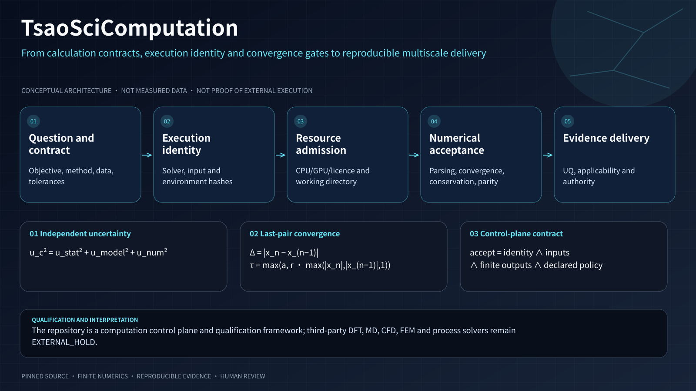

> The repository is a computation control plane and qualification framework; third-party DFT, MD, CFD, FEM and process solvers remain EXTERNAL_HOLD.

#### Independent uncertainty

$$
u_c=\sqrt{u_{\mathrm{stat}}^2+u_{\mathrm{model}}^2+u_{\mathrm{num}}^2}
$$

Components must be finite, nonnegative and expressed in the same output units. Quadrature assumes uncorrelated contributions. The implementation uses math.hypot to avoid intermediate squaring overflow and rejects unrepresentable totals. Correlated contributions require covariance propagation, not this interface.

Source mapping: [`tsao_computation/uncertainty/model.py`](tsao_computation/uncertainty/model.py)

#### Last-pair convergence

$$
\Delta=|x_n-x_{n-1}|,\qquad \tau=\max\!\left(a,r\max(|x_n|,|x_{n-1}|,1)\right),\qquad\Delta\le\tau
$$

This gate compares the final two finite values using absolute tolerance a and relative tolerance r. Its threshold uses max, not an additive tolerance. The scale floor of one is expressed in the chosen input units, so normalize units or nondimensionalize first. Passing the last pair does not prove global trajectory convergence or adequate sampling.

Source mapping: [`tsao_computation/validation/numerical.py`](tsao_computation/validation/numerical.py)

#### Control-plane contract

$$
C_{\mathrm{accept}}=C_{\mathrm{identity}}\land C_{\mathrm{input}}\land C_{\mathrm{finite}}\land C_{\mathrm{policy}}
$$

This is an explanatory composition of runner and adapter requirements, not a fitted score or a single function shared by every engine. Preserve engine versions, input hashes, parser evidence and applicable acceptance policies separately. Software discovery, generated inputs and parsed examples are not external scientific execution.

Source mapping: [`tsao_computation/adapters/base.py`](tsao_computation/adapters/base.py) · [`tsao_computation/execution/runner.py`](tsao_computation/execution/runner.py)

#### Serialized provenance append

$$
E_{n+1}=E_n\mathbin{\Vert}[e_{n+1}],\quad \lvert\operatorname{UTF8}(E_{n+1})\rvert\le64\times2^{20}\;\mathrm{bytes}
$$

Events must be JSON objects; nested duplicate keys, NaN, Infinity, floating-point overflow or nonzero underflow to zero, and non-UTF-8 input are rejected. Cooperating writers serialize read–append–atomic-replace operations through an exclusive sidecar lock, preventing lost updates. This is a local-file protocol, not a distributed database transaction; explicit archival is required at the 64 MiB bound. Lock acquisition times out after 10 seconds. An abandoned lock is not stolen automatically; confirm the writer has exited and back up the ledger before recovery.

On Windows, the C runtime can report a sharing or delete-pending conflict as `EACCES`. Lock creation retries that error within the same 10-second acquisition deadline, and still requires a successful exclusive create before any ledger update. Persistent access denial is re-raised as the original `PermissionError`; other permission errors and non-Windows permission failures propagate immediately. A failed acquisition never removes another writer's lock. These semantics follow the Microsoft [`_open` error mapping](https://learn.microsoft.com/en-us/cpp/c-runtime-library/reference/open-wopen?view=msvc-170) and [`CreateFile` deletion rules](https://learn.microsoft.com/en-us/windows/win32/api/fileapi/nf-fileapi-createfilea).

Source mapping: [`tsao_computation/provenance/ledger.py`](tsao_computation/provenance/ledger.py) · [`tests/test_provenance_ledger_integrity.py`](tests/test_provenance_ledger_integrity.py)

### Usage and acceptance sequence

1. Check the installation environment, input structure, units, applicability and execution permissions.
2. Use the source mappings above to distinguish native implementation, explanatory contracts and external execution requirements.
3. Run focused regression and full quality gates before long-duration testing of pinned commits.
4. Preserve original logs, machine-readable reports and limitations; missing evidence must never be reported as PASS.

```bash
python scripts/verify_all.py --profile core
python scripts/verify_all.py --profile quality
python scripts/verify_native_core.py
```

Retest every changed commit. Baseline regression, two three-hour regression segments, browser visual checks and external engineering qualification are distinct evidence classes. Without original receipts, no six-hour completion is claimed.

Implementation anchors: [`tsao_computation/adapters/base.py`](tsao_computation/adapters/base.py) · [`tsao_computation/execution/runner.py`](tsao_computation/execution/runner.py) · [`tsao_computation/validation/numerical.py`](tsao_computation/validation/numerical.py)

<!-- CURRENT_MAIN_ACCEPTANCE_V2:END -->
