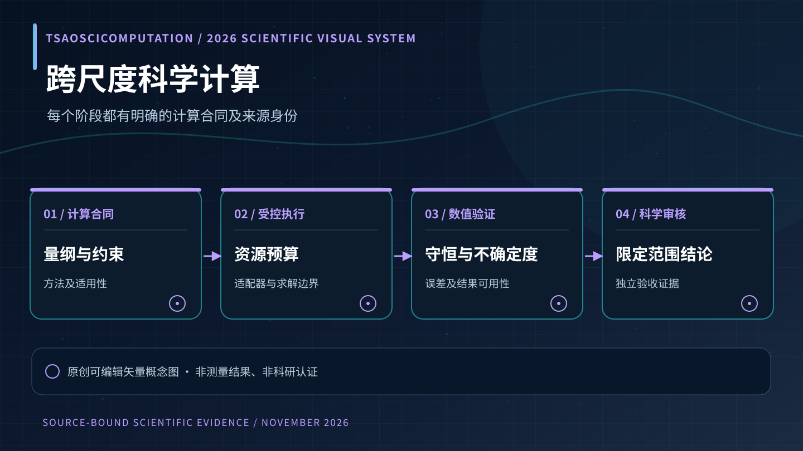

# TsaoSciComputation

**让每一次跨尺度计算可追溯：把科学问题、计算合同、受控执行与可审阅证据连接起来。**

[English](README.md) · [根 Skill](SKILL.md) · [系统架构](docs/architecture.md) · [能力索引](capability-index/README.md) · [科学验证](docs/scientific-validation.md)


*本图采用 AI 艺术设计与确定性文字排版。它不是求解器截图、实测曲线或外部执行证据。下文逐项说明数学合同对应的实现与适用限制。*

## 架构可视化：来源、计算与证据



可编辑概念图，不是外部求解器结果；实际资格必须依据源代码、条件与测试记录核验。

## 1. 这个仓库能够交付什么

TsaoSciComputation 是 Python 科学计算**控制平面**：建立明确的计算合同，选择已登记的方法和工作流，准备有边界的执行计划，解析提供的输出，并分别记录数值检查与科学验收。DFT、MD、CFD、FEM 和流程模拟等外部引擎需要独立安装、许可与资格验证。

| 已实现能力 | 主要实现 | 实际输出与边界 |
|---|---|---|
| 科学问题路由与严格合同验证 | [路由器](tsao_computation/routing/router.py)、[CalculationContract](tsao_computation/contracts/calculation.py) | 路由决策、缺失字段和机器可读计划；有效计划不等于已计算结果 |
| 注册的本地数学函数 | [编排器](tsao_computation/orchestration/planner.py) | 七个许可名单函数：衡算、收敛、不确定度、参考检查、单位查询和证据门禁 |
| 外部适配器协议 | [Adapter](tsao_computation/adapters/base.py) | 解析后的命令/输入协议及文本观察；未实现的执行协议保持不可执行 |
| 有授权、有边界的本地执行 | [执行器](tsao_computation/execution/runner.py)、[资源准入器](tsao_computation/execution/resources.py) | 进程记录、文件身份、部分批次证据、CPU/GPU/许可证准入和超时进程树清理 |
| 带量纲物理量与模型交接 | [ScientificQuantity](tsao_computation/scientific_quantity.py)、[HandoffRecord](tsao_computation/contracts/handoff.py) | 受控单位、绑定来源的转换及不可变交接载荷 |
| 科学置信等级与审批 | [验收](tsao_computation/validation/acceptance.py)、[置信等级](tsao_computation/validation/confidence.py) | 缺失证据、已验证审批数量和 C0–C5 分级 |
| 可重复的软件交付 | [verify_all.py](scripts/verify_all.py)、[原生核心](native/README.md) | 原有质量门禁、源码/wheel 可重复构建、SBOM 和原生 C ABI 检查 |

<!-- SUPER_SKILL_ORCHESTRATION:START -->
### 能力清单是路由合同

当前注册表包含 **164 项能力、27 个外部适配器和 20 套工作流**；编排层声明 **23 类方法、13 类加速策略和七个可信本地函数**。可以通过 `list capabilities`、`list adapters`、`list workflows`、`list methods` 和 `list invocations` 检查实际清单。

这些数量描述已登记的合同与集成路径，不表示仓库内置了 27 个数值引擎或 23 套数值算法。通用服务、容器、调度器和 Skill 目标在独立授权实现提供执行证据前仅用于规划。详见[编排文档](docs/orchestration.md)及其[机器可读审计](reports/ULTIMATE_COMPUTATION_SUPER_SKILL_AUDIT.json)。
<!-- SUPER_SKILL_ORCHESTRATION:END -->

## 2. 安装并取得第一个结果

要求 Python **3.10+**。永久 CI 矩阵覆盖 **Windows 和 Linux**，使用 Python 3.10 与 3.13。运行时没有强制第三方依赖；验证和发布工具从带文件哈希的锁定依赖中独立安装。

```bash
git clone https://github.com/SUNHAOJUN22/TsaoSciComputation.git
cd TsaoSciComputation
python -m venv .venv
```

Linux 使用 `source .venv/bin/activate`，Windows PowerShell 使用 `.venv\Scripts\Activate.ps1` 激活，然后执行：

```bash
python -m pip install --require-hashes --only-binary=:all: -r requirements-ci.txt
python -m pip install --no-index --no-deps --no-build-isolation -e '.[validation,quality,security]'
python -m tsao_computation --version
python -m tsao_computation route "DFT to MD to CFD with explicit uncertainty and handoff validation"
python -m tsao_computation validate-contract examples/dft-md-cfd/contract.json --strict
python -m tsao_computation plan examples/dft-md-cfd/contract.json --strict
python -m tsao_computation invoke scientific-benchmarks --execute
```

示例合同是**准备阶段模板**，其中的方法意图与占位内容需要替换为真实材料、几何、参数和参考数据。严格验证检查字段完整性与结构，并不证明输入内容真实。最后一条命令执行仓库本地的八项解析解/不变量检查，不运行第三方求解器。

下面的 Python 示例完全在本地执行：

```python
from decimal import Decimal

from tsao_computation import ScientificQuantity
from tsao_computation.uncertainty import combine_independent
from tsao_computation.validation import balance_check, convergence_check

pressure = ScientificQuantity(
    value=Decimal("1.25"),
    unit="MPa",
    dimension=(-1, 1, -2, 0, 0, 0, 0),
    source_id="synthetic-readme-example",
    basis="REFERENCE",
    uncertainty=Decimal("0.05"),
)
converted = pressure.convert(unit="Pa", dimension=pressure.dimension)
assert converted.value == Decimal("1250000")
assert converted.uncertainty == Decimal("50000")
assert converted.source_quantity_digest == pressure.digest
assert balance_check(10.0, 7.0, 3.0, tolerance=1e-12)["passed"]
assert convergence_check([1.0, 1.0000001], absolute_tolerance=1e-6)["passed"]
assert combine_independent(3.0, 4.0, 0.0) == 5.0
```

依赖锁和更新策略见 [CI_DEPENDENCY_POLICY.md](docs/CI_DEPENDENCY_POLICY.md)。依赖哈希证明文件身份，漏洞评估仍是独立的发布检查。

## 3. 根据任务选择执行策略

| 你的场景 | 建议路径 | 继续前必须具备的证据 |
|---|---|---|
| 有科学问题，但没有安装求解器 | `route` → 严格合同 → `plan` | 目标量、单位、条件、假设、参数来源、收敛和验证计划 |
| 小规模本地数学检查 | `invoke` 七个注册函数之一，或调用其 Python API | 有限输入、明确容差/单位解释和完整结果记录 |
| 已有 GROMACS、QE 或 ORCA | 探测身份 → 准备输入协议 → 授权精确计划 → 执行 | 二进制/输入哈希、调用入口、环境、工作目录和资源声明 |
| Python 模块适配器 | 使用拥有依赖模块的解释器及声明的 `.py` 驱动 | 模块位置探测和解释器身份；不同虚拟环境不能混用 |
| 多尺度研究 | 上游计算 → 不可变交接 → 下游模型 | 单位、参考态、条件、不确定度、重叠适用域及每次转移的审阅 |
| GPU/MPI 或原生加速方案 | 剖析 → 可信 CPU 参考 → 等价性 → 同问题性能比较 | 求解器能力指纹、数值容差以及工作负载/环境身份 |

### 已实现的命令构建协议

[`Adapter.build_command()`](tsao_computation/adapters/base.py) 支持以下具体输入协议：

| 适配器 | 已解析可执行文件之后的参数 | 输入要求 |
|---|---|---|
| GROMACS | `mdrun -s system.tpr` | 已预处理的 `.tpr`；预处理单独执行 |
| Quantum ESPRESSO | `-i scf.in` | PWscf 输入文件 |
| ORCA | `water.inp` | ORCA 输入文件 |
| 已声明的 Python 模块适配器 | `driver.py` | Python 驱动及同一解释器中的必要模块 |
| 其它适配器记录 | 没有通用可执行命令 | 先实现并验证对应引擎协议 |

构建的计划初始为 `execute_allowed=False`。执行层把授权绑定到具体计划，不把“已发现软件”当成执行许可。`invoke --execute` 仅适用于注册的仓库本地函数，不运行任意 shell，也不会让所有适配器自动变成可执行服务。

```bash
python -m tsao_computation probe --workers 4
python -m tsao_computation probe-solver gromacs --output .tsao-computation/gromacs-evidence.json
python -m tsao_computation plan-acceleration gromacs --solver-evidence .tsao-computation/gromacs-evidence.json --require-solver-evidence
```

这些命令检查可用性并进行有边界的版本探测。`version-probed-unqualified` 与 `evidence-bound-unqualified` 仍需要数值资格验证。缺失可执行文件、证据不完整或协议未实现时，系统保留明确的待证状态。

Python 模块发现使用隔离的 `-I -S` 子进程，不导入父包，不执行 `sitecustomize`，不处理 `.pth` 启动钩子。只有使用同一调用解释器的适配器才可以合并探测；不同虚拟环境入口分别检查，合并探测没有跨调用的可用性缓存。对应[模块隔离测试](tests/test_module_probe_isolation.py)、[合并探测测试](tests/test_grouped_adapter_probe.py)及[解释器执行测试](tests/test_python_environment_execution.py)。

## 4. 代码中实现的数学合同

本节每个数值公式都链接到实现。方法选择记录与科学审批规则明确作为合同说明，不描述成拟合数值模型。

### 4.1 物理量、量纲与受控仿射换算

一个物理量记录数值 $x$、单位 $u$、七维量纲指数 $\mathbf d$、来源 $s$、数值依据 $b$ 及可选不确定度 $u_x$：

$$
Q=(x,u,\mathbf d,s,b,u_x),\qquad
\mathbf d=(d_L,d_M,d_T,d_\Theta,d_N,d_I,d_J).
$$

量纲顺序是长度、质量、时间、温度、物质的量、电流和发光强度。受控[单位注册表](tsao_computation/quantity_units.py)给出比例 $a$、除数 $d$ 与缩放前偏移 $o$：

$$
x_{\mathrm{SI}}=(x_s+o_s)\frac{a_s}{d_s},\qquad
x_t=x_{\mathrm{SI}}\frac{d_t}{a_t}-o_t,
\qquad
u_t=u_s\left|\frac{a_s d_t}{d_s a_t}\right|.
$$

例如 `degC` 使用 $o_s=273.15$；`degF` 使用 $o_s=459.67$、$a_s=5$、$d_s=9$。温差使用 `delta_` 单位且偏移为零。绝对温度与温差不能互转；不确定度只缩放，不能加上绝对温度的偏移。

[`ScientificQuantity.convert`](tsao_computation/scientific_quantity.py)采用完全指定的 **50 位有效十进制数字、ROUND_HALF_EVEN 舍入上下文**，不继承调用方的精度、舍入方式、指数限制或异常设置。绝对温度准入使用精确的零开尔文边界，要求 $T>0\,\mathrm K$。支持的非零十进制指数范围为 $[-308,308]$。换算仍可能在 50 位处舍入，结果越界或违反物理边界时仍会失败；它不是任意精度符号运算。

布尔值、未知单位、不相容量纲、负不确定度，以及与注册表矛盾的自定义换算因子都会被拒绝。换算结果记录 `basis="DERIVED"` 和原始物理量摘要。摘要识别规范化记录的具体表示，不保证所有不同格式或不同单位的等价物理量拥有同一摘要。回归测试：[Decimal 上下文隔离](tests/test_decimal_context_isolation.py)。

### 4.2 有限标量准入与末两点收敛

[`convergence_check`](tsao_computation/validation/numerical.py)先检查每个观测值，再比较末两个值：

$$
\Delta=|x_n-x_{n-1}|,\quad
s=\max(|x_n|,|x_{n-1}|,1),\quad
\tau=\max(a,r s),\quad
G_{\mathrm{conv}}=(\Delta\le\tau).
$$

$a\ge0$ 与观测值同单位，$r\ge0$ 无量纲。尺度下限 1 按输入的数值单位解释，因此应先规范单位或无量纲化，再选容差。实际阈值是**取最大值**，不是 $a+r s$。

布尔值、非有限值及转换为浮点数时变成零的非零输入都被拒绝。数字字符串、`Decimal`、`Fraction` 使用同一转换检查；真正的带符号零和可表示的次正规数仍有效。少于两个观测值或存在无效观测值都会失败。仅通过该检查不能证明整条轨迹收敛、采样充分、网格独立或达到全局最优。直接调用的失败诊断可能包含无穷哨兵；可信调用层在哈希前把这些诊断转成 JSON 安全的证据。参见[下溢回归](tests/test_nonzero_underflow_contract.py)。

### 4.3 明确积累方向的守恒检查

[`balance_check`](tsao_computation/validation/physical.py)计算已经统一单位与时间基准的输入：

$$
r_b=\operatorname{fsum}(I,-O,-A),\qquad
s_b=\max(|I|,|O|,|A|,1),\qquad
e_b=\frac{|r_b|}{s_b},\qquad G_b=(e_b\le\varepsilon).
$$

$I$ 是输入，$O$ 是输出，$A$ 是积累，控制体内物质或能量增加时取正。容差 $\varepsilon\ge0$ 无量纲。补偿求和保留可表示的抵消残差；溢出、非有限输入和归一化后被下溢抹成零的非零残差都属于错误。单位换算、组分化学计量和反应模型适用性必须在调用前建立，不能由小残差反推成立。

### 4.4 独立标准不确定度

[`combine_independent`](tsao_computation/uncertainty/model.py)计算

$$
u_c=\operatorname{hypot}(u_1,\ldots,u_k)
=\sqrt{\sum_{i=1}^k u_i^2},\qquad u_i\ge0.
$$

`UncertaintyBudget` 分别命名统计、模型和数值分量。各分量必须同单位、具有兼容的标准不确定度解释；平方和假设分量不相关。`math.hypot` 避免可避免的中间平方溢出，最终非有限结果或被下溢抹零的非零输入仍被拒绝。空分量列表的数学结果是零，不能把它当成“所有不确定度来源都已评估”的证据。

存在相关性时，一阶传播需要

$$
u_y^2=\mathbf J\,\boldsymbol\Sigma\,\mathbf J^{\mathsf T},
$$

其中 $\mathbf J$ 是灵敏度行向量，$\boldsymbol\Sigma$ 是协方差矩阵。这个公式用于说明**边界**：`combine_independent` 没有实现协方差传播，存在相关性时必须另行提供经过验证的模型。参见[结果范围回归](tests/test_uncertainty_result_range.py)。

### 4.5 模型交接保留科学含义

[`HandoffRecord`](tsao_computation/contracts/handoff.py)绑定来源模型、接收模型、目标量、数值、单位、条件、参考态、统计/模型不确定度、适用域和变换过程。身份定义为

$$
H_H=\operatorname{SHA256}\!\left(\operatorname{CanonicalJSON}(P_H)\right),
$$

$P_H$ 严格对应 `canonical_payload()`。审阅决定和签名不进入该载荷，避免循环签名；审阅必须绑定其精确摘要，另一个数值或变换过程的审批不能复用。

数值允许有限标量或非空矩形数组，最多六层嵌套、100,000 个标量单元。不确定度非负，并与数组形状一致，或者显式提供一个标量上界。结构化不确定度必须带量纲兼容的单位；接口保留其原单位，组合前必须换算。嵌套数据会复制并冻结，调用者修改原列表不能改变已准入记录。`checked` 表示软件合同检查，`validated` 还需要绑定该载荷的外部已验证审批。

### 4.6 解析器观察输入文本

[`Adapter.parse`](tsao_computation/adapters/base.py)保留文本摘要、解析器版本、检测到的引擎版本文本和当前运行起点。检测到新的运行开始后，前一次运行的成功标记不能替代后一次被截断运行的成功。正反观察概括为

$$
G_{\mathrm{complete}}=P_c\land\neg N_c,\qquad
G_{\mathrm{converged}}=G_{\mathrm{complete}}\land P_v\land\neg N_v.
$$

$P_c,P_v$ 分别是识别出的完成/收敛正标记，$N_c,N_v$ 是相应负标记。`not normal termination`、`SCF not yet converged` 和 `converged=false` 不会变成成功。这些是文本观察，不独立证明可执行文件身份或物理正确性；解析器的 `validated` 保持 false。应另外保留原始输出字节及执行记录，尤其在解码改变了文本时。参见[解析回归](tests/test_performance_optimizations.py)。

### 4.7 资源准入与执行身份

本地[资源准入器](tsao_computation/execution/resources.py)只在声明的可加容量内接纳并发任务集合 $\mathcal P$：

$$
\sum_{p\in\mathcal P}r_{p,j}\le c_j.
$$

$r_{p,j}$ 是任务 $p$ 的 CPU 或许可证资源需求，$c_j$ 是对应容量。GPU 还要求设备属于许可集合、独占使用且可见性设置一致。这是本地资源控制，不能替代外部集群调度器，也不能证明许可证服务器可用。

[执行器](tsao_computation/execution/runner.py)把精确命令、可执行文件调用路径及解析后的目标、可执行文件/输入字节、工作目录和环境绑定到授权计划。文件身份为

$$
H_f=\operatorname{SHA256}(\mathrm{bytes}_f).
$$

超时清理覆盖进程树。批次失败保留已完成记录，并通过索引对应原始请求；缺失进程记录是失败，不会补造成功。资源释放不表示收敛或验收通过。参见[执行边界测试](tests/test_execution_boundary_contract.py)及[超时测试](tests/test_process_timeout_containment.py)。

### 4.8 验收是证据门禁

[`acceptance_gate`](tsao_computation/validation/acceptance.py)要求七个严格布尔条件：

$$
G_S=C\land P\land V\land F\land U\land D\land E,
\qquad
G_A=G_S\land H\land A_{\mathrm{verified}}.
$$

$C$：已完成；$P$：已解析；$V$：已收敛；$F$：已做物理验证；$U$：已量化不确定度；$D$：已确认适用域；$E$：已绑定证据。$H$ 是有效的工件 SHA-256，$A_{\mathrm{verified}}$ 是至少一份有效且在时间窗口内、角色和用途符合要求的外部证明。这些标记是声明的证据输入，不是自动判断科学真假的算法。

内置门禁使用记录**外部**提供的可信密钥验证 HMAC-SHA256 证明，要求用途 `scientific-result-acceptance`、角色 `independent-domain-reviewer`，并要求申请人与审批人身份不同。C5 额外要求决策范围、安全审查和独立复现的签名证据；重复的合格 nonce 不能跨不同治理用途计数。实现不是持久化的跨请求重放数据库、机构身份服务或密钥撤销服务，需要这些能力的部署必须另行提供。独立的公开 `acceptance_is_verified` API 把签名验证交给调用方验证器，且只接受字面布尔值 `True`。

### 4.9 本地溯源具有明确存储上限

[哈希链溯源账本](tsao_computation/provenance/ledger.py)在追加前验证已有记录。严格 JSON 拒绝重复键、非有限值，以及非零十进制数转浮点后消失的下溢。另一个[并发事件账本](tsao_computation/execution_boundary.py)采用排他侧车锁与原子替换，并设置 64 MiB 上界：

$$
|\operatorname{UTF8}(E_{n+1})|\le64\times2^{20}\;\mathrm{bytes}.
$$

这是协作式本地文件协议。等待锁超时或旧账本损坏时会失败，不会默默抢占遗留锁。恢复前应确认写入进程已退出并保留账本。哈希链证明记录完整性，不证明其中测量值真实。

## 5. 解析参考检查及其假设

[`scientific_benchmarks.py`](tsao_computation/validation/scientific_benchmarks.py)执行八项确定性软件参考：

| 参考检查 | 数学目标 | 假设或范围 |
|---|---|---|
| 一维稳态导热 | $T(x)=T_L+(T_R-T_L)x/L$ | 常物性、无内热源；有限差分剖面 |
| 泊肃叶流动 | $Q=\pi\Delta p R^4/(8\mu L)$ | 稳态层流牛顿流体圆管；径向积分 |
| 一级反应 CSTR | $C=C_{in}/(1+k\tau)$ | 理想稳态全混；反应衡算闭合 |
| 一级反应 PFR | $C/C_0=e^{-k\tau}$ | 恒定一级反应速率；RK4 参考积分 |
| 简谐振子 | $E=(x^2+v^2)/2$ | 单位质量和刚度；速度 Verlet 能量漂移 |
| 高斯链 | $\langle R^2\rangle=Nb^2$ | 理想各向同性独立链段 |
| 平行板 | $\lvert\mathcal E\rvert=V/d$ | 线性电势、忽略边缘效应；中心差分 |
| 电热平衡 | $VI=I^2R=G\Delta T$ | 稳态集总散热；电阻与热导恒定 |

$k$ 为反应速率常数，$\tau$ 为停留时间，$\mu$ 为黏度，$R$ 根据表中行分别表示管半径或电阻，$G$ 为热导，$b$ 为链段长度。每个函数在代码中固定参考参数与容差；通过意味着该测试夹具和数值不变量满足条件，不表示任意材料、本构关系或外部引擎已获得验证。

## 6. 统一验证与交付证据

```bash
python scripts/verify_all.py --profile all
python scripts/verify_native_core.py
python scripts/verify_all.py --profile benchmark
python -m pytest -q tests/test_performance_v9.py tests/test_performance_optimizations.py
python scripts/run_large_parser_regression.py
python scripts/final_acceptance_preflight.py --json
```

`all` 执行原有 quality、core 和 package 配置，包含 Ruff、格式、Mypy、Bandit、仓库安全扫描、受控变异、完整 pytest、**95% 总覆盖率**、关键模块覆盖率、科学参考、Schema/注册表审计、派生文件一致性、可重复源码/wheel 构建、隔离安装、SBOM 和校验和。原生 C ABI、benchmark 和性能命令仍是额外门禁。大日志解析回归使用生成的本地文本，不是实测求解器输出。

<!-- CURRENT_MAIN_VERIFICATION:START -->
### 资格属于精确提交

| 元数据 | 内容 |
|---|---|
| 版本 | 3.0.4 |

请查阅待交付提交对应的永久 [CI 工作流](.github/workflows/ci.yml)和原始工件。`reports/` 中的历史文件是快照；此前的绿灯或局部测试不能验证新提交。六小时回归需要原始回执绑定精确源码 SHA、成功测试进程的累计耗时和全部失败证据，本 README 不预先宣称其完成。外部引擎在独立证据补齐前保持 **EXTERNAL_HOLD**。
<!-- CURRENT_MAIN_VERIFICATION:END -->

## 7. 保留证据地诊断与恢复

| 观察到的现象 | 含义 | 下一步 |
|---|---|---|
| 严格合同拒绝由示例改出的研究 | 必需科学字段缺失或无效 | 用有依据的数据替换占位内容，再生成计划 |
| `candidate-only` / `detected-incomplete` | 注册或环境发现不完整 | 独立安装/配置目标引擎，再次探测 |
| `version-probed-unqualified` | 已有二进制/版本身份 | 补充固定参考输入、数值容差和资格验证输出 |
| `execute_allowed=False` | 准备好的计划尚未授权 | 审阅具体可执行文件/输入/环境身份，在接收环境授权 |
| 非有限值、下溢或温度边界错误 | 数值或物理输入不受支持 | 修正来源单位、范围或模型假设，保留被拒原始记录 |
| 已完成但未收敛/验证 | 仅执行或解析成功 | 查原生诊断，并执行声明的收敛/物理检查 |
| 验收缺失审批或工件绑定 | 科学审阅证据缺失或不匹配 | 对实际工件摘要取得独立验证的审批 |
| Manifest 或派生报告漂移 | 已提交证据不再描述当前源码 | 用仓库脚本重建，审阅差异，再跑原有门禁 |

不要通过写入 `accepted=true`、编造数值或把未知量填成零来补证据。模型、单位变换、输入或可执行文件发生改变时，重新构建受影响的计划与证据链。

## 8. 文档、历史图谱与项目约定

两份主 README 分别使用对应语言的概念设计图。**43 张历史 Scientific Research Console V13 SVG** 保留在[技术图谱](assets/visuals/README.md)，并继续遵守原有[设计与安全约定](assets/visuals/DESIGN_SYSTEM.md)。它们解释方法与集成愿景，不表示外部求解器已真实执行；原始源文件保持可检查并继续通过安全审查，不被静默替换。

进一步阅读：[适配器文档](adapters)、[工作流文档](skills/workflows)、[场景示例](examples)、[发布策略](docs/release.md)、[验收指南](README_ACCEPTANCE.md)、[原生 ABI](native/README.md)和[第三方边界](THIRD_PARTY.md)。

`main` 是唯一权威长期分支。Windows 与 Linux 是支持的交付平台。仓库不捆绑商业求解器、许可证或私有数据集。MIT 许可：[LICENSE](LICENSE)；引用元数据：[CITATION.cff](CITATION.cff)。

<!-- CURRENT_MAIN_ACCEPTANCE_V2:START -->
### 维护中的源码索引

[适配器与解析](tsao_computation/adapters/base.py) · [执行记录](tsao_computation/execution/runner.py) · [收敛](tsao_computation/validation/numerical.py) · [不确定度](tsao_computation/uncertainty/model.py) · [历史中文架构图](docs/current-main/tsao-scicomputation-current-main-zh.svg)

上文公式与策略描述当前实现。概念图和历史工件不是执行证明，源码变化后必须重新取得资格证据。
<!-- CURRENT_MAIN_ACCEPTANCE_V2:END -->
