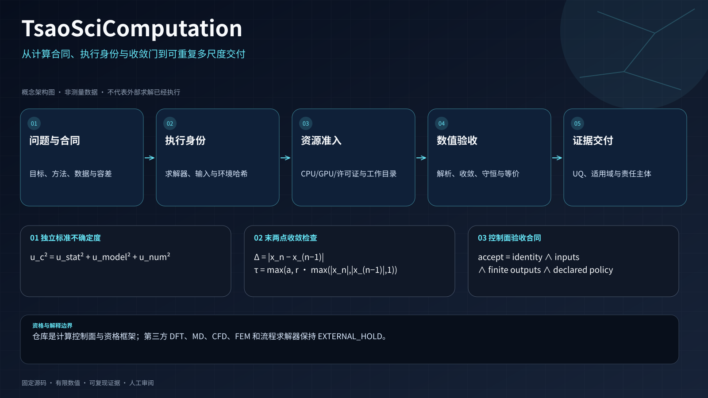

<div align="center">


# TsaoSciComputation

**从方程、求解器身份到可重复交付的证据治理型科学计算编排系统。**

     

[English](README.md) · [根 Skill](SKILL.md) · [能力索引](capability-index/README.md) · [视觉图谱](assets/visuals/README.md) · [科学验证](docs/scientific-validation.md) · [系统架构](docs/architecture.md) · [本轮交付 Prompt](docs/autonomous-software-hardening-prompt.md)

</div>

<!-- LOCALIZED_VISION_ZH:START -->
## 中文项目愿景图：从基本方程到可复现科学计算

<p align="center">
  
</p>

> 图中方程对应合同、执行身份、收敛、不确定度和验收模块；图不代表 VASP、Gaussian、GROMACS、OpenFOAM 或 Aspen 已经运行。

<!-- LOCALIZED_VISION_ZH:END -->

## 当前交付状态

当前实现和交付门禁如下，是否通过以待部署提交对应的完整证据为准：

- **164 项能力**、**27 个外部适配器**、**20 套机器可读工作流**；
- 测试数量和实测覆盖率以待部署精确提交的完整 CI 工件为准；总覆盖率门槛保持 **95.00%**；
- Ruff、Mypy、Bandit、仓库安全扫描、受控变异、Schema、Manifest、可重复源码/Wheel、隔离安装、SBOM 与原生 C ABI 验证均属于必需交付门禁；
- 远端仅保留唯一权威分支 **`main`**；
- 第三方求解器真实执行仍保持 **`EXTERNAL_HOLD`**，直至提供真实二进制、许可证、固定输入、硬件指纹、参考结果与科学容差。

软件资格、外部求解器资格和科学结论分别记录，历史成功报告不能替代新提交的验证。

## 仓库的真实定位

TsaoSciComputation 将科学问题转化为受治理的计算程序：

```text
问题 → 计算合同 → 方法/尺度路由 → 环境预检 → 有边界执行
     → 结果解析 → 收敛 → 数值/物理验证
     → 不确定度/适用域 → 接受、拒绝或保持待证
```

它是**控制平面与资格框架**，不是内置的 DFT、MD、CFD、FEM 或流程模拟器。Python 负责合同、路由、策略、溯源和验收；外部数值引擎必须独立安装、许可和科学资格验证。经真实剖析确认的软件热点，可通过版本化 C ABI 迁移到 C++20/OpenMP 或求解器原生加速路径。

### 明确不作出的声明

- 不伪造 VASP、Quantum ESPRESSO、Gaussian、GROMACS、OpenFOAM、Aspen 或商业软件运行结果；
- 没有可信 CPU 参考时，不声明 GPU/MPI 数值等价；
- 不把仓库本地编排 benchmark 冒充生产求解器加速比；
- 不把进程返回码等同于科学验收。

## 快速开始

```bash
git clone https://github.com/SUNHAOJUN22/TsaoSciComputation.git
cd TsaoSciComputation
python -m pip install -e '.[validation,quality,security]'

python -m tsao_computation route \
  "规划一个带显式不确定度门禁的 DFT 到 MD 界面研究"

python -m tsao_computation validate-contract \
  templates/calculation-contract.json --strict

python -m tsao_computation probe
python scripts/verify_all.py --profile all
python scripts/verify_native_core.py
```

外部执行独立进行：

```bash
python -m tsao_computation probe-solver gromacs \
  --output .tsao-computation/gromacs-capability-evidence.json

python -m tsao_computation plan-acceleration gromacs \
  --solver-evidence .tsao-computation/gromacs-capability-evidence.json \
  --require-solver-evidence
```

完整指纹最多自动达到 `version-probed-unqualified`，仍不能证明数值正确、收敛、许可证可用或加速器等价。

<!-- SUPER_SKILL_ORCHESTRATION:START -->
## 能力与执行模型

仓库提供 **164 项能力**、**23 类计算方法**、**9 类调用方式**、**7 个可信本地函数**、**27 个外部适配器**、**20 套工作流**、**13 类加速策略**和**9 阶段编排计划**。

| 调用方式 | 默认行为 |
|---|---|
| 已注册可信本地函数 | 通过载荷校验和请求/结果哈希后才可执行 |
| 外部求解器或适配器 | 仅探测并生成命令计划；执行需独立授权 |
| Python 模块、CLI、API、容器、调度器或其他 Skill | 在运行时、身份和证据条件满足前仅生成声明式交接 |

执行采用 fail-closed。相对可执行文件和输入均以规范化后的 `CommandPlan.cwd` 为基准解析。裸命令名仅按清洗后的不可变 `PATH` 解析一次，转为绝对路径、计算哈希并在启动前重新绑定；实际进程使用的目录就是已授权的规范化工作目录。
<!-- SUPER_SKILL_ORCHESTRATION:END -->

## 架构概览

<table>
<tr>
<td width="50%"></td>
<td width="50%"></td>
</tr>
<tr>
<td align="center"><strong>受治理的科学智能体</strong></td>
<td align="center"><strong>基于合同的能力系统</strong></td>
</tr>
</table>

### 控制平面、原生平面与外部引擎

| 层次 | 职责 | 验收边界 |
|---|---|---|
| Python 控制平面 | 合同、路由、证据、溯源、策略、解析器、不确定度与决策 | 仓库确定性资格验证 |
| 原生互操作平面 | 通过版本化 C ABI 进行 C++20/OpenMP 发现和已测热点计算 | ABI、构建、CTest 与等价门禁 |
| 外部求解器平面 | DFT/MD/CFD/FEM/流程模拟执行 | 真实安装、许可证、固定输入、参考值与容差证据 |

## 数理运行模型

下列公式逐项对应所链接的 Python 实现。愿景图里的 DFT、MD、CFD、FEM 和流程模型表达预期应用场景；本仓库负责编排这些外部引擎，未在内部实现其控制方程求解器。

### 1. 显式计算合同

[`CalculationContract`](tsao_computation/contracts/calculation.py) 记录问题、体系、工况和观测量，并附带假设、模型对象、尺度、方法、边界与初始条件、参数来源、收敛与验证计划、不确定度、计算资源、预期产物、审查节点及接受标准。结构预检要求必需字段均已提供：

$$
G_{\mathrm{preflight}}=\bigwedge_{f\in F_{\mathrm{required}}}\operatorname{present}(f).
$$

这是一项完整性检查。非空的假设、参数来源或验证方案仍需领域审查；规划模块不会把经验闭合关系提升成物理定律，也不会补造缺失的求解器数据。

### 2. 数量、单位和量纲绑定

[`ScientificQuantity`](tsao_computation/scientific_quantity.py) 将有限 Decimal 数值、受控单位、七维整数量纲、来源标识、数据依据和可选的非负不确定度绑定在同一记录中。量纲顺序固定为**长度、质量、时间、温度、物质的量、电流、发光强度**：

$$
\mathbf d=(d_L,d_M,d_T,d_{\Theta},d_N,d_I,d_J),\qquad
[\mathrm{Pa}]=L^{-1}MT^{-2},\qquad [\mathrm{Pa\,s}]=L^{-1}MT^{-1}.
$$

带版本的[单位注册表](tsao_computation/quantity_units.py) 同时确定量纲与换算系数。能量 `J/eV/hartree` 和摩尔能 `J/mol/kJ/mol` 的量纲不同；两者之间需要显式的物质的量或粒子数模型，不能靠改单位标签完成转换。

以规范值 $x_c=a_s(x_s+b_s)$、$x_c=a_t(x_t+b_t)$ 表示仿射换算，代码执行：

$$
x_t=\frac{a_s(x_s+b_s)}{a_t}-b_t,\qquad
u_t=\left|\frac{a_s}{a_t}\right|u_s.
$$

标准不确定度只应用比例系数，不应用温标偏移。华氏温标采用有理系数计算，绝对温度和温差分开建模。例如 $32\,{}^\circ\mathrm F=273.15\,\mathrm K$，而 $1.8\,{}^\circ\mathrm F$ 的不确定度转换为 $1\,\mathrm K$。绝对温度不得低于或等于零开尔文，负温差仍合法。未知单位、与注册表矛盾的调用者系数、布尔值、非有限值以及非零 Decimal 的十进制指数超出 $[-308,308]$ 都会被拒绝。

```python
from decimal import Decimal
from tsao_computation.scientific_quantity import ScientificQuantity

pressure = ScientificQuantity(
    value=Decimal("1.25"), unit="MPa",
    dimension=(-1, 1, -2, 0, 0, 0, 0),
    source_id="instrument:pressure-01", uncertainty=Decimal("0.05"),
)
pressure_pa = pressure.convert(unit="Pa", dimension=pressure.dimension)
assert pressure_pa.value == Decimal("1250000")
assert pressure_pa.uncertainty == Decimal("50000")
assert pressure_pa.source_quantity_digest == pressure.digest
```

派生记录保留父记录摘要，依据类型为 `DERIVED`。反序列化入口 `from_mapping()` 会重新检查单位、量纲及注册表元数据，不直接信任输入标签。

### 3. 有限数域与实际收敛判据

[`convergence_check`](tsao_computation/validation/numerical.py) 遍历全部输入，拒绝布尔值和非有限观测，然后比较**最后两个**有效值。当前实现的阈值是取最大值，不能写成绝对项与相对项相加：

$$
\Delta=|x_n-x_{n-1}|,\quad s=\max(|x_n|,|x_{n-1}|,1),\quad
\tau=\max(\tau_{\mathrm{abs}},\tau_{\mathrm{rel}}s),\quad
G_{\mathrm{conv}}=(\Delta\leq\tau).
$$

两个容差均须有限且非负。少于两个观测或任一观测非法时检查失败。这项局部检查不能证明收敛阶、稳态、网格独立性、非线性方程残差或全局最优性；需要将这些条件单独写入计算合同并提供证据。受信任调用层会在序列化和哈希前，把非法浮点哨兵转为 JSON 可表达的失败证据。

### 4. 守恒残差明确累计项的符号

[`balance_check`](tsao_computation/validation/physical.py) 按相同单位、相同时间基准执行标量守恒检查：

$$
r=I-O-A,\qquad
r_{\mathrm{norm}}=\frac{|r|}{\max(|I|,|O|,|A|,1)},\qquad
G_{\mathrm{balance}}=(r_{\mathrm{norm}}\leq\varepsilon).
$$

其中 $A$ 是累计项，正值表示控制体中有物料或能量积累。输入、输出、累计项和容差都必须有限，容差不能为负。该函数不推断反应化学、不汇总不同物理基准的流量，也不自动把质量流量改成摩尔流量；单位不兼容应在进入标量残差计算前拒绝。

### 5. 独立不确定度及适用条件

[`combine_independent`](tsao_computation/uncertainty/model.py) 使用 `math.hypot` 稳定计算平方和开根号：

$$
u_c=\sqrt{u_{\mathrm{stat}}^2+u_{\mathrm{model}}^2+u_{\mathrm{num}}^2},\qquad u_i\geq0.
$$

各分量必须已经采用相同单位，并代表可比较的标准不确定度。实现拒绝非有限分量及溢出的合成结果，不估计相关性。存在相关性时，应由具体模型实现：

$$
u_y^2=\mathbf J\,\boldsymbol\Sigma\,\mathbf J^{\mathsf T},
$$

其中 $\mathbf J$ 为灵敏度行向量，$\boldsymbol\Sigma$ 为输入协方差矩阵。协方差传播是需要扩展的模型计算，不是 `combine_independent` 已实现的功能。采样误差、模型形式误差和数值误差应先分别保存，确认解释和单位后再合成。

### 6. 跨模型交接同时约束数值与证据

[`HandoffRecord`](tsao_computation/contracts/handoff.py) 将源模型、接收模型、观测量、值、单位、工况、参考态、统计/模型不确定度、适用域和变换绑定：

$$
H_{\mathrm{handoff}}=\operatorname{SHA256}\!\left(\operatorname{CanonicalJSON}
(M_s,M_t,q,x,u,C,R,U_s,U_m,\Omega,T)\right).
$$

值只接受有限实数标量或非空规则数组，最多六层嵌套、100,000 个标量单元。任意分布字典不会被当作数值解释。不确定度必须非负，数组形状与值一致，或明确提供一个标量界限；结构化不确定度还必须附带同量纲单位。它自己的单位会被保留，使用者必须先换算到共同单位再合成。

嵌套工况、数组、不确定度和证据都会复制并冻结。调用者修改原来的列表，不会改变已经接收的记录及其摘要。`to_dict()` 与 `from_mapping()` 提供重新检查合同的序列化路径。`checked` 表示软件合同检查；`validated` 还要求外部可信审批验证这一精确科学载荷。摘要排除审查结论和签名，避免循环签名；其他数值、工况或变换上的有效签名不能移用于本记录。

### 7. 文本解析与执行、科学验证分开

[`Adapter.parse`](tsao_computation/adapters/base.py) 返回明确文本中的完成/收敛观察、解析器版本、检测到的引擎版本文字或 `unknown`、输入 UTF-8 文本摘要及当前运行段偏移。识别到后续任务开始时，不会借用前一任务的成功标记让尚未结束的任务通过。否定观察优先于成功文字：

$$
G_{\mathrm{text,complete}}=P_{\mathrm{complete}}\land\neg N_{\mathrm{complete}},\qquad
G_{\mathrm{text,converged}}=G_{\mathrm{text,complete}}\land P_{\mathrm{conv}}\land\neg N_{\mathrm{conv}}.
$$

`SCF not yet converged`、`not normal termination`、`converged=false` 等输入不能被提升为成功。通用及引擎特定成功标记只描述**文本状态**；解析器不能独立证明日志是谁生成的、可执行文件是否可信或科学模型是否有效，`validated` 始终为假。原始输出字节和真实执行记录应另行保存，尤其不能把文本解码后的摘要冒充原始字节摘要。

### 8. 正式接受统一经过验证门禁

[`acceptance_gate`](tsao_computation/validation/acceptance.py)、[`ScientificStateMachine`](tsao_computation/state/machine.py) 和 [`assess_confidence`](tsao_computation/validation/confidence.py) 共用绑定制品的接受规则：

$$
G_{\mathrm{accept}}=
\left(\bigwedge_{j=1}^{7} b_j\right)
\land\operatorname{ValidDigest}(H)
\land\operatorname{Verify}_{K_{\mathrm{trusted}}}(\sigma,H,\mathrm{scope},\mathrm{role},t).
$$

七项布尔条件分别为完成、解析、数值收敛、物理验证、不确定度量化、适用性确认和证据绑定。这些字段是声明的证据摘要，签名及外部审查者构成审查边界。审批必须具有 `scientific-result-acceptance` 作用域、`independent-domain-reviewer` 角色、不同的请求者/批准者标识和有效时间窗口。可信密钥来自调用环境，不能从结果载荷中自报。

C0–C3 表示逐级丰富的已声明证据；C4 要求通过签名验证的科学接受；C5 还要求独立的 `engineering-decision`、`safety-review`、`independent-reproduction` 签名及对应角色，全部绑定同一制品和显式决策范围。“专家已审核”字符串、调用者布尔开关或内嵌密钥均不能让记录达到 C4/C5。

禁止直接构造已接受状态。从物理验证转到科学接受，必须提供同一条已验证记录，且状态转移证据等于该制品摘要。状态和事件通过公共接口保持不可变；仅用任意文字走完整个状态序列，不能获得正式接受。

单独导出的兼容接口 `acceptance_is_verified()` 与 `require_verified_acceptance()` 将签名验证委托给调用方配置的可信校验器。只有校验器明确返回布尔值 `True` 才能接受封装记录；`False`、`"false"` 等字符串、数字状态码、容器、自定义真值对象及校验异常均被拒绝。该接口不会调用结果对象的 `__bool__()`，也不自行完成密码学验证或授予 C4/C5 等级。实际校验器必须依据部署环境的可信策略验证规范消息、签名和审查者身份。

### 9. 溯源和资源申请保持可审计

[`hashing.py`](tsao_computation/hashing.py) 对 JSON 使用排序键、紧凑分隔及有限数规则，文件摘要按受限块读取。执行绑定包含规范化命令/工作目录、可执行文件身份、输入身份和环境。授权摘要来自结构化绑定，而不是有歧义的显示字符串拼接：

$$
H_{\mathrm{authorization}}=\operatorname{SHA256}(\operatorname{CanonicalJSON}(B)),\qquad
H_{\mathrm{file}}=\operatorname{SHA256}(\mathrm{bytes}_{\mathrm{file}}).
$$

资源准入要求 CPU、GPU 和许可证申请兼容。对于可加资源：

$$
\sum_{p\in\mathcal P_{\mathrm{active}}}r_{p,j}\leq c_j,
$$

GPU 还需独占和设备可见性约束。这些是本地调度与证据控制；求解器性能、CPU/GPU 等价性和模型准确度，需要单独测量的工作负载及参考结果。

本轮真实生产入口的回归见 [`tests/test_acceptance_repair.py`](tests/test_acceptance_repair.py)；原有接受、数值、资源分配和执行测试继续保留。

## 资格与交付示意图

以下 AI 辅助信息设计均以确定性、仓库自持 SVG 源码交付，只说明软件逻辑，不伪造求解器输出。


<!-- V13_VISUAL_SYSTEM:START -->
仓库包含 **43 幅自包含 SVG**，统一使用 **Scientific Research Console V13**。根中英文 README 展示 **12 幅代表性示意图**；完整可检索图谱见 [`assets/visuals/README.md`](assets/visuals/README.md)，设计与信任规范见 [`assets/visuals/DESIGN_SYSTEM.md`](assets/visuals/DESIGN_SYSTEM.md)。
<!-- V13_VISUAL_SYSTEM:END -->

## 使用策略

### 已实现的执行协议

27 个适配器条目描述路由和环境能力；检测到程序不等于所有适配器均可运行。[`Adapter.build_command()`](tsao_computation/adapters/base.py) 当前实现的输入协议如下：

| 适配器路径 | 可执行文件后的参数 | 必需输入 |
|---|---|---|
| GROMACS | `mdrun -s system.tpr` | 已预处理的 `.tpr` 文件；预处理是独立操作 |
| Quantum ESPRESSO | `-i scf.in` | PWscf 输入文件 |
| ORCA | `water.inp` | ORCA 输入文件 |
| 已声明的 Python 模块适配器 | `driver.py` | `.py` 驱动脚本及该解释器中必需的模块 |
| 其他适配器条目 | 不生成可执行的通用参数 | 需要实现引擎特定协议并完成资格验证 |

GROMACS 与 QE 参数分别对应 [GROMACS mdrun 官方文档](https://manual.gromacs.org/current/onlinehelp/gmx-mdrun.html)和 [QE 输入文件说明](https://www.quantum-espresso.org/Doc/pw_user_guide/node21.html)。生成的计划均保留 `execute_allowed=False`；执行前还需将程序/输入字节、工作目录和环境绑定授权。测试中的替身程序只能验证参数构造，不能证明外部求解器科学正确。

### 现有证据的迁移策略

旧记录若包含未知单位、矛盾量纲、任意换算系数、负不确定度、自由文本审批或直接构造的已接受状态，现在会被拒绝。应从真实来源重新构造记录，不能用占位审批填补缺失证据。尚未经过外部审查的常规交接使用 `checked` 或 `unvalidated`；`validated` 必须提供绑定 `handoff.digest` 的签名接受记录，并由接收环境独立提供可信密钥。

```python
from tsao_computation.validation import assess_confidence
from tsao_computation.state import ScientificStateMachine

# record 来自经过资格检查的证据包。
# trusted_keys 由接收环境配置，不能从 record 自报字段读取。
assessment = assess_confidence(record, trusted_approval_keys=trusted_keys)
machine = ScientificStateMachine("physically-validated")
machine.transition(
    "scientifically-accepted", evidence=record["artifact_sha256"],
    acceptance_record=record, trusted_approval_keys=trusted_keys,
)
```

没有外部可信上下文时，置信度接口不能达到 C4。C5 还需分别签署决策、安全审查和独立复现作用域。HMAC 验证提供已配置可信域内的完整性保护；真实审查者身份、密钥保护、撤销和持久防重放策略仍由部署环境负责。

### 策略 A：没有求解器时先完成科学规划

使用 `route`、合同校验和能力/工作流检索，形成可辩护的计算程序。输出应保持为计划或 `EXTERNAL_HOLD`，不得虚构运行证据。

### 策略 B：接入外部求解器

准备最小证据包：

```text
qualification-bundle/
├── solver-identity.json        # 路径、大小、SHA-256、版本输出
├── environment.json            # OS、运行时、库、调度器、设备
├── inputs/                     # 固定规范输入
├── references/                 # 可信 CPU 或解析参考
├── tolerances.json             # 针对可观测量的数值容差
├── license-evidence.json       # 许可证可用性与授权边界
└── provenance.json             # 证据包哈希与复核权限
```

随后依次验证身份、正确性、等价性和性能。

### 策略 C：边缘计算部署

- 预打包注册表、Schema、模板、视觉资产与文档；
- 除非边缘加速器已明确指纹化，否则采用 CPU-only；
- 限制 worker 和内存，优先使用确定性本地函数与声明式交接；
- 仅把哈希绑定的证据包转移到大型求解器主机。

### 策略 D：共享 HPC 部署

- 将不可变计划声明映射到调度器 CPU/GPU/许可证请求；
- 分离 scratch、checkpoint 与最终证据目录；
- 将调度器元数据、可执行文件身份和环境绑定到 provenance；
- 只重试已分类的暂态基础设施故障，不能把不收敛解释为机器故障。

### 策略 E：加速计算

1. 先盘点代码并剖析真实工作负载；
2. 区分编排开销与数值核开销；
3. 优先采用求解器原生并行和成熟库，再考虑自定义 kernel；
4. 建立 CPU 正确性与确定性参考；
5. 按声明的可观测量和容差证明 GPU/MPI 等价；
6. 在同一已资格问题上测量性能，并报告测量不确定度。

### 策略 F：验收与审计

每一项声明都应表达为

$$
\text{声明}=(\text{可观测量},\text{参考},\text{容差},
\text{证据},\text{权限}).
$$

任一元素缺失，都应降低声明等级或继续保持待证。

## 多尺度科学计算视觉图谱


## 加速计算与原生互操作

Python 保持为控制平面。只有当真实剖析证明收益显著、且边界可以独立测试时，热点才应迁移到 C++/OpenMP/CUDA。


```bash
python scripts/build_acceleration_audits.py
python -m tsao_computation audit-acceleration \
  --root . --scope production --limit 50 --min-score 40 \
  --output reports/ACCELERATION_OPPORTUNITIES_PRODUCTION_V4.json
python -m tsao_computation profile-performance \
  --workload routing-hot --workload acceleration-plan \
  --repeats 7 --warmups 1 \
  --output .tsao-computation/performance-profile.json
```

<!-- ACCELERATION_AUDIT_SUMMARY:START -->
源码数量与摘要以自动生成的[生产审计](reports/ACCELERATION_OPPORTUNITIES_PRODUCTION_V4.json)和[全树审计](reports/ACCELERATION_OPPORTUNITIES_FULL_TREE_V4.json)为准。未完成实测剖析的代码不构成外部求解器或 GPU 加速证据。
<!-- ACCELERATION_AUDIT_SUMMARY:END -->

架构、CUDA-X 选型与 C++ 迁移门禁见 [`docs/accelerated-native-backend.md`](docs/accelerated-native-backend.md)。原生验证命令：`python scripts/verify_native_core.py`。

## 验证与验收证据

```bash
python -m pip install -e '.[validation,quality,security]'
python scripts/verify_all.py --profile all
python scripts/verify_native_core.py
python scripts/verify_all.py --profile benchmark
```

`all` 覆盖质量、lint、format、类型、安全、测试、覆盖率、受控变异、科学参考夹具、Schema/注册表、生成文件一致性、可重复源码/Wheel、隔离安装、SBOM、校验和与发布清单。`benchmark` 仅提供环境相关的编排遥测，不是外部求解器性能证据。

<!-- CURRENT_MAIN_VERIFICATION:START -->
### 精确提交的软件资格

| 元数据 | 数值 |
|---|---|
| 版本 | 3.0.4 |

以永久 [CI 工作流](.github/workflows/ci.yml) 对待部署 SHA 的结果及工件为准。`reports/` 中的历史报告只是对应版本的快照，不能为新提交提供证明。完整 pytest、95% 总覆盖率门槛、关键模块覆盖率、生成文件校验、Ruff、mypy、Bandit、变异探针、源码包/Wheel 可重复构建、原生 C ABI 和平台矩阵仍是必要门禁。单一合同测试或前一提交的成功结果不能替代完整验证链。
<!-- CURRENT_MAIN_VERIFICATION:END -->

### 外部批准合同

`software_ready` 汇总调用记录声明的完成、解析、收敛、物理验证、不确定度、适用性与证据绑定状态，不等于独立科学批准。

`accepted` 还要求合法的制品 SHA-256，以及使用记录外部可信密钥验证、处于有效期内的 HMAC-SHA256 鉴证。接受门要求作用域为 `scientific-result-acceptance`，角色为 `independent-domain-reviewer`，批准者与请求者标识不同；可信密钥配置及真实身份解析由部署方独立完成。

非法 JSON 载荷、非有限值、循环引用及序列化失败返回结构化拒绝原因。无效签名或不匹配的作用域、角色不会抢占 nonce 并阻止后续有效审批。重复有效审批仅在**单次决策内**去重，不代表已实现跨请求防重放数据库、密钥撤销服务或机构身份认证。需要这些控制的系统必须外部提供；对同一制品在批准有效期内重复验证是允许的。

专项回归命令：

```bash
python -m pytest -q tests/test_acceptance_repair.py tests/test_approval_attestation_boundaries.py tests/test_validation_fail_closed.py
```


## 信任边界

| 状态 | 含义 |
|---|---|
| `candidate-only` | 注册表候选，尚未检测到可执行文件 |
| `detected-incomplete` | 已检测，但必要证据不完整 |
| `fingerprinted-unqualified` | 已记录精确二进制身份，尚无数值资格 |
| `version-probed-unqualified` | 已记录受限版本输出，仍未科学资格验证 |
| `evidence-bound-unqualified` | 证据已绑定进计划，正确性/等价性仍待验证 |
| `EXTERNAL_HOLD` | 缺少必要的外部事实或证据 |

## 平台与仓库策略

- Windows 是核心支持流程，Linux 已通过 CI 验证；
- `main` 是唯一权威远端分支；
- 仓库不打包外部求解器、商业许可证或私有数据集；
- 发布物包含可重复制品、SPDX/CycloneDX SBOM、SHA-256 校验和与 provenance。

## 许可证与引用

采用 MIT 许可证。引用元数据见 [`CITATION.cff`](CITATION.cff)，第三方边界见 [`THIRD_PARTY.md`](THIRD_PARTY.md)。

<!-- CURRENT_MAIN_ACCEPTANCE_V2:START -->
## 当前实现：代码、数学与使用策略



> 仓库是计算控制面与资格框架；第三方 DFT、MD、CFD、FEM 和流程求解器保持 EXTERNAL_HOLD。

#### 独立标准不确定度

$$
u_c=\sqrt{u_{\mathrm{stat}}^2+u_{\mathrm{model}}^2+u_{\mathrm{num}}^2}
$$

各分量必须有限、非负，并使用同一输出单位；平方和要求分量互不相关。实现使用 `math.hypot` 避免直接平方造成的中间溢出，并拒绝不可表示的最终结果。相关项必须另行采用协方差传播，不能套用该接口。

源码对应: [`tsao_computation/uncertainty/model.py`](tsao_computation/uncertainty/model.py)

#### 末两点收敛检查

$$
\Delta=|x_n-x_{n-1}|,\qquad \tau=\max\!\left(a,r\max(|x_n|,|x_{n-1}|,1)\right),\qquad\Delta\le\tau
$$

该门比较末两个有限数值，绝对容差为 a、相对容差为 r；阈值使用 `max`，不是两项相加。数值尺度的下限 1 按输入单位解释，因此应先规范单位或无量纲化。通过末两点检查不证明轨迹整体收敛或统计采样充分。

源码对应: [`tsao_computation/validation/numerical.py`](tsao_computation/validation/numerical.py)

#### 控制面验收合同

$$
C_{\mathrm{accept}}=C_{\mathrm{identity}}\land C_{\mathrm{input}}\land C_{\mathrm{finite}}\land C_{\mathrm{policy}}
$$

这是执行层和适配器约束的解释性组合，不是一个拟合分数或所有引擎共享的单一函数。必须分别保存引擎版本、输入校验和、解析证据和适用的验收规则；仅发现软件、生成输入文件或解析示例不等于完成外部科学计算。

源码对应: [`tsao_computation/adapters/base.py`](tsao_computation/adapters/base.py) · [`tsao_computation/execution/runner.py`](tsao_computation/execution/runner.py)

#### 可追溯事件的串行追加

$$
E_{n+1}=E_n\mathbin{\Vert}[e_{n+1}],\quad \lvert\operatorname{UTF8}(E_{n+1})\rvert\le64\times2^{20}\;\mathrm{bytes}
$$

事件必须是 JSON 对象；嵌套重复键、NaN、Infinity、浮点溢出和非 UTF-8 输入拒绝进入账本。协作写入者通过排他侧车锁串行执行读—追加—原子替换，避免多个进程覆盖彼此的事件。此为本地文件协议，不是分布式数据库事务；64 MiB 上界到达时需要显式归档。等待锁最多 10 秒，崩溃遗留锁不会被自动抢占；维护者应确认写入者已退出并备份账本后再恢复。

Windows 的 C 运行库可能将共享冲突或等待删除状态报告为 `EACCES`。创建锁遇到该错误时，只在同一个 10 秒获取期限内重试；必须成功排他创建锁后才能更新账本。持续访问拒绝仍原样抛出 `PermissionError`，其他权限错误及非 Windows 平台的权限失败立即向调用方传播。获取失败绝不删除其他写入者的锁。此行为依据微软 [`_open` 错误映射](https://learn.microsoft.com/en-us/cpp/c-runtime-library/reference/open-wopen?view=msvc-170)与 [`CreateFile` 删除语义](https://learn.microsoft.com/en-us/windows/win32/api/fileapi/nf-fileapi-createfilea)。

源码对应: [`tsao_computation/provenance/ledger.py`](tsao_computation/provenance/ledger.py) · [`tests/test_provenance_ledger_integrity.py`](tests/test_provenance_ledger_integrity.py)

### 使用与验收顺序

1. 先核对安装环境、输入结构、单位、有效范围与执行权限。
2. 按上面的源码锚点区分原生实现、解释性合同和外部执行要求。
3. 先运行快速回归和完整质量门，再用固定提交执行长期回归。
4. 逐项保存原始日志、机器报告和限制；任何缺失证据不得写成 PASS。

```bash
python scripts/verify_all.py --profile core
python scripts/verify_all.py --profile quality
python scripts/verify_native_core.py
```

每次修复均须绑定新提交重新测试。基线回归、两段各三小时的重复回归、浏览器图形检查和外部工程认证是不同证据，不可互相替代。没有原始回执时，不宣称已完成六小时验收。

源码锚点: [`tsao_computation/adapters/base.py`](tsao_computation/adapters/base.py) · [`tsao_computation/execution/runner.py`](tsao_computation/execution/runner.py) · [`tsao_computation/validation/numerical.py`](tsao_computation/validation/numerical.py)

<!-- CURRENT_MAIN_ACCEPTANCE_V2:END -->
