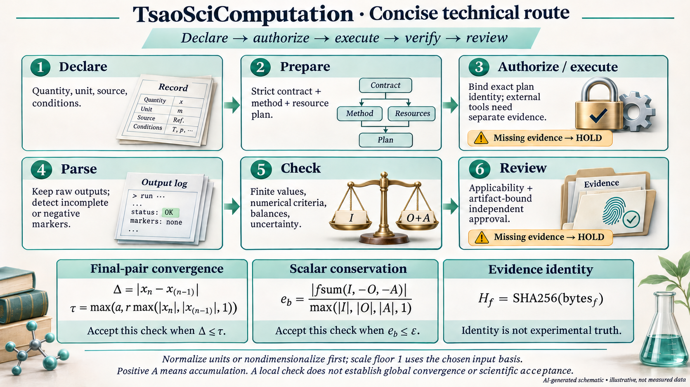

# TsaoSciComputation — Software preflight and scientific acceptance / 软件预检与科学验收

[English section](#english-acceptance-and-operating-contract) · [中文](#中文交付预检与科学验收) · [English README](README.md) · [中文 README](README.zh-CN.md)



*AI-generated illustrative technical route / AI 生成技术路线示意。The figure contains no measurements and grants no scientific approval. / 图中没有测量数据，也不授予科学审批。[Generation provenance / 生成来源](docs/assets/ai-generated/manifest.json).*

## 中文：交付预检与科学验收

TsaoSciComputation 是科学计算控制面。支持交付平台为 **Windows 和 Linux**。本页说明软件合同、证据身份和独立审批如何协作；它不是一次外部求解器或实验已经完成的报告。外部结果缺少适用资格、原始输出或审批时，保持 **EXTERNAL_HOLD**。

### 1. 从可审查合同开始

[`CalculationContract`](tsao_computation/contracts/calculation.py) 要求明确目标量、单位、输入来源、条件、模型假设、方法及验证计划。`route` 是方法选择，严格合同验证是结构/字段检查，`plan` 是执行准备。示例合同中的占位内容需要真实科学记录替换；有效 JSON 不能证明物理模型适用。

采用统计力学模型时，先声明系综与状态空间。固定 $N,V,T>0$ 的正则关系 $Z=\sum_i e^{-\beta E_i}$、$F=-k_BT\ln Z$ 是理论背景；不能把本地理想链参考当作配分函数求解器或充分采样证明。详细假设见[统计力学背景](docs/scientific-contracts.zh-CN.md#统计力学背景)。

### 2. 精确执行身份

[`_bound_plan()`](tsao_computation/execution/runner.py) 对规范载荷计算计划摘要。为保留本页原有术语，$H_{bundle}$ 仅作为该**计划身份**的文档别名：

\[
H_{bundle}:=H_{plan}=\operatorname{SHA256}(\operatorname{CanonicalJSON}(P_{plan})),
\qquad H_f=\operatorname{SHA256}(\mathrm{bytes}_f).
\]

$P_{plan}$ 的实际字段是规范化 argv、工作目录、排序后的环境、适配器标识、解析后的可执行文件路径、可执行文件 SHA-256、输入路径与输入 SHA-256。这不是任意把求解器、参考数据和文档字节串联后的新“总哈希”。输入与可执行文件改变时，原授权不能继续使用。输出日志、解析器身份和科学参考应另行保存并绑定相应证据。

新计划初始 `execute_allowed=False`，仅有已安装程序不代表授权。已有命令构建协议是 GROMACS `mdrun -s system.tpr`、QE `-i scf.in`、ORCA `water.inp` 和已声明的 Python `driver.py`；其他注册路径需先实现对应协议。探测到版本或设备仍未取得数值资格。

### 3. 局部数值门禁及其单位

[末两点收敛](tsao_computation/validation/numerical.py)使用最大阈值：

\[
\Delta=|x_n-x_{n-1}|,\quad
s=\max(|x_n|,|x_{n-1}|,1),\quad
\tau=\max(a,rs),\quad G_{conv}=(\Delta\le\tau).
\]

$a$ 与观测值同单位，$r$ 无量纲，二者有限且非负。尺度下限 1 采用输入基准，先统一单位或无量纲化。函数先检查全部观测值，再比较末两个值；通过不能证明全轨迹收敛、网格无关、平衡采样或全局最优。

[守恒检查](tsao_computation/validation/physical.py)要求输入 $I$、输出 $O$ 与正积累 $A$ 使用共同单位及时间基准：

\[
e_b=\frac{|\operatorname{fsum}(I,-O,-A)|}{\max(|I|,|O|,|A|,1)},\qquad G_b=(e_b\le\varepsilon).
\]

$\varepsilon$ 有限、非负且无量纲。补偿求和不是自动单位换算或化学计量验证；非有限值、算术溢出、非零输入/残差被下溢抹成零时保持拒绝。

[固定科学参考](tsao_computation/validation/scientific_benchmarks.py)采用其各自参数与容差：参考非零时比较相对误差，参考为零时比较绝对误差。八项本地算例不是八种已执行外部求解器。[固定参数与假设表](docs/scientific-contracts.zh-CN.md#参考夹具)。

### 4. 解析与资源准入

[解析器](tsao_computation/adapters/base.py)观察提供的文本。完成与收敛标记分开，负标记覆盖对应正结论；新的运行起点使更早成功不再适用于后续截断运行。解析器 `validated` 为 false，原始输出字节和执行记录仍需保留。

本地 **resource admission** [资源准入](tsao_computation/execution/resources.py) 对 CPU 与许可证容量使用可加约束：

\[
\sum_{p\in\mathcal P}r_{p,j}\le c_j.
\]

GPU 还需要许可设备集合中的成员资格、独占占用与可见性设置一致。不要把 GPU 身份简化成任意可加标量；本地准入也不能替代集群调度器或证明许可证服务器可用。外部求解器的线程设置和实际资源使用仍需部署方配置并验证。

### 5. 不确定度、适用域与审批

实际[独立不确定度合成](tsao_computation/uncertainty/model.py)为：

\[
u_c=\operatorname{hypot}(u_1,\ldots,u_k),\qquad u_i\ge0.
\]

各分量必须是不相关、同单位、解释兼容的标准不确定度。相关性的一阶理论表达 $u_y^2=J\Sigma J^{\mathsf T}$ 需要另行验证的模型，本函数未实现协方差传播。没有填写分量不能证明已评估全部不确定度。

[`acceptance_gate`](tsao_computation/validation/acceptance.py)要求 completed、parsed、converged、physically_validated、uncertainty_quantified、applicability_confirmed、evidence_bound 七项严格布尔值均为真；另需合法工件摘要与绑定该工件、用途、角色和时间窗口的已验证独立审批。部署方提供可信密钥，申请人与审批人不同。它检查声明的证据和审批，不能独自裁定科学真实性；持久化防重放、机构身份与撤销服务需部署方另行提供。[治理细节](docs/scientific-contracts.zh-CN.md#48-验收是证据门禁)。

### 6. 性能与原生边界

[性能实现](tsao_computation/performance/runner.py) 默认七次重复、一次预热。静态整数计数在 setup/operation 前检查；批次先物化再检查全部计数。实际吞吐在实测后进行有限值验证，短时长引发溢出时拒绝结果，**不回滚已执行操作**。工作负载、主机、缓存、计时器和数值等价证据共同决定比较范围，不能由计数合法推出一定更快。

原生 C++20 的版本化 C ABI 与 `ctypes` 桥接支持 CPU/OpenMP/可选 CUDA Runtime 发现；不是所有 GPU 算法已实现或运行的证明。[性能准入](docs/scientific-contracts.zh-CN.md#性能准入)与[原生构建](docs/scientific-contracts.zh-CN.md#原生构建与资格验证)给出完整边界。

### 7. 原有验证入口

```bash
python scripts/verify_all.py --profile all
python scripts/verify_native_core.py
python scripts/verify_all.py --profile benchmark
python -m pytest -q tests/test_performance_v9.py tests/test_performance_optimizations.py
python scripts/run_large_parser_regression.py
python scripts/final_acceptance_preflight.py --json
```

保留原有测试、覆盖率、变异、Schema/注册表、派生文件、可重复构建、隔离安装和依赖锁门禁。命令清单本身不是执行回执；实际状态应来自精确候选源码的日志与永久 CI 工件。大日志解析器输入是生成文本，并非实测外部输出。

### 8. 预检 PASS 的含义

[`final_acceptance_preflight.py`](scripts/final_acceptance_preflight.py) 的 `PASS` 只表示其命名的软件交付检查通过：必需文件、编码、支持平台声明、注册数量、保留的历史 SVG 合同与文件身份等。报告明确给出 `solver_or_experiment_executed=false`、`automatic_scientific_approval=false` 和 `external_boundary=EXTERNAL_HOLD`。它不替代完整验证配置或外部科学验收。

## English: acceptance and operating contract

TsaoSciComputation is a scientific-computation control plane with **Windows and Linux** as supported delivery platforms. This page describes software contracts and evidence review. It does not report a completed external solver run or experiment. Missing applicable qualification, raw output or independent approval retains **EXTERNAL_HOLD**.

### Contract and identity

State the observable, units, source, conditions, assumptions, method and validation plan in a [calculation contract](tsao_computation/contracts/calculation.py). Routing selects declared methods; strict contract validation checks completeness and structure; planning prepares execution. Template placeholders still need real scientific records. For statistical-mechanics work, state the ensemble and observable; the local ideal-chain covariance check does not implement a partition-function solver or prove equilibrium sampling. [Theoretical context](docs/scientific-contracts.md#statistical-mechanics-context).

The legacy notation $H_{bundle}$ on this page is only an alias for the implemented **plan hash**:

\[
H_{bundle}:=H_{plan}=\operatorname{SHA256}(\operatorname{CanonicalJSON}(P_{plan})).
\]

The [bound-plan payload](tsao_computation/execution/runner.py) contains normalized argv, working directory, sorted environment, adapter slug, resolved executable path, executable hash, input path and input hash. Individual file identity is $H_f=\operatorname{SHA256}(\mathrm{bytes}_f)$. This is not a newly implemented concatenation of solver, reference and document bytes. Retain output bytes, parser identity and reference evidence separately. Changes to the bound executable/input/environment invalidate the corresponding authorization.

New plans start with `execute_allowed=False`. Implemented protocols cover GROMACS `.tpr`, QE `.in`, ORCA `.inp` and declared Python drivers. Other registry entries need an engine-specific protocol before execution. Version probing or device discovery remains unqualified identity evidence.

### Numerical, physical and parser gates

The [final-pair convergence check](tsao_computation/validation/numerical.py) uses $\Delta=|x_n-x_{n-1}|$ and $\tau=\max(a,r\max(|x_n|,|x_{n-1}|,1))$, accepting this check when $\Delta\le\tau$. Absolute tolerance $a$ has the observable's unit; relative tolerance $r$ is dimensionless. Normalize units or nondimensionalize before interpreting the numeric scale floor 1. The whole sequence is admitted, but only the final pair is compared; trajectory convergence, grid independence and sampling adequacy are separate scientific questions.

The [balance check](tsao_computation/validation/physical.py) computes $|\operatorname{fsum}(I,-O,-A)|/\max(|I|,|O|,|A|,1)$ with **positive accumulation** $A$, common units/time basis and finite nonnegative dimensionless tolerance. It does not perform unit conversion or stoichiometric validation. Nonfinite values, overflow and nonzero-to-zero underflow are not silently successful.

The [eight fixed reference cases](tsao_computation/validation/scientific_benchmarks.py) use their own parameters and tolerances: relative error for a nonzero reference and absolute error for a zero reference. They are local deterministic software fixtures, not external engine qualification. [Exact fixture table](docs/scientific-contracts.md#reference-fixtures).

[Parsing](tsao_computation/adapters/base.py) observes supplied text. Completion and convergence remain separate, negative markers veto corresponding claims, and an earlier successful run cannot qualify a later truncated run. Parser `validated` remains false. Preserve raw bytes and execution identity.

### Resource admission, uncertainty and approval

Local [resource admission](tsao_computation/execution/resources.py) sums CPU and license claims against capacity. GPU admission additionally enforces membership in the allowed device set, exclusive allocation and visibility agreement. This local control does not replace a cluster scheduler or prove that a license server is available; actual solver thread/resource configuration remains a deployment responsibility.

[Independent standard uncertainty](tsao_computation/uncertainty/model.py) uses $u_c=\operatorname{hypot}(u_1,\ldots,u_k)$ for nonnegative, uncorrelated components in a common unit. First-order covariance propagation $u_y^2=J\Sigma J^{\mathsf T}$ is theoretical background requiring a separately validated model. The implemented norm does not estimate missing uncertainty components or propagate covariance.

The [acceptance gate](tsao_computation/validation/acceptance.py) requires seven strict boolean predicates—completed, parsed, converged, physically validated, uncertainty quantified, applicability confirmed and evidence bound—plus a valid artifact hash and verified independent approval bound to artifact, purpose, role and validity window. Trusted keys come from the deployment, not the candidate record. Applicant and reviewer differ. These are evidence predicates, not an autonomous scientific truth test. Persistent replay protection, institutional identity and revocation services remain external. [Governance limits](docs/scientific-contracts.md#48-acceptance-is-an-evidence-gate).

### Performance and delivery evidence

The profiler defaults to seven repeats and one warmup. It validates static integer counts before setup/operation, including the entire materialized batch. Computed throughput is finite-checked **after measured execution**; overflow rejects the record without undoing the workload. Same-input, same-host, cache-policy, numerical-equivalence and timer evidence determine a valid comparison. A finite fallback for zero duration is not infinite speed. [Detailed admission contract](docs/scientific-contracts.md#performance-admission).

The optional native C++20 core supplies a stable C ABI and `ctypes` discovery bridge for CPU/OpenMP/optional CUDA Runtime capability. Discovery does not establish an executed GPU scientific kernel or a speedup. [Build and qualification](docs/scientific-contracts.md#native-build-and-qualification).

Run the original commands above and retain actual exit codes and logs for the exact candidate. The `all` profile and additional native/benchmark/parser gates retain their original scope and thresholds. Historical reports cannot qualify changed source. The named delivery preflight's `PASS` checks repository paths, encoding, platform declarations, registry inventory, retained historical SVG contracts and file identities; its report explicitly says `solver_or_experiment_executed=false`, `automatic_scientific_approval=false` and `EXTERNAL_HOLD`. It is neither a full-suite receipt nor scientific acceptance.

## AI visual declaration / AI 图像声明

The current figure is a complete, unchanged imagegen PNG with visible illustrative labeling. [Exact prompts and output identities](docs/assets/ai-generated/README.md) distinguish current generated artwork from historical files. The [legacy acceptance SVG](docs/assets/acceptance/final-acceptance-map.svg) remains unchanged for historical inspection and the original preflight contract; its old “AI-ASSISTED” text does not make it a new imagegen output. It is no longer embedded as the current acceptance illustration.

当前图为完整且未经修改的 imagegen PNG，带有可见示意标签。历史验收 SVG 保留用于原有预检契约与历史检查，旧有 “AI-ASSISTED” 文本不构成本轮 imagegen 来源证明，也不再作为当前验收图嵌入。
