# README visual assets

This directory contains the complete visual atlas for TsaoSciComputation. The root READMEs now contain language-specific AI-assisted hero designs in `docs/assets/readme-vnext/`. This atlas preserves the original 43 technical SVGs, including the 12 former README figures below.

## Design and trust policy

- Every asset is a self-contained SVG with an accessible `<title>` and `<desc>`.
- Assets use no external fonts, scripts, raster images, network resources, event handlers or tracking elements.
- Diagrams explain architecture, mathematics, qualification and scientific boundaries; they are not solver screenshots or claims of live third-party execution.
- Text labels remain consistent with registries, workflows and machine-readable evidence.
- Relative paths keep visuals available in repository clones and source archives.

## Scientific Research Console V13

All 43 assets declare `data-design-system="uiux-pro-max-scientific-console-v4"`.

- Five information layouts are used: Hero, Bento, Workflow, Loop and Risk.
- One line-icon system and explicit labels reinforce meaning beyond color.
- SVG body text is at least 16 px.
- No external fonts, scripts, raster images, gradients, filters, event handlers or tracking are permitted.
- The 12 former README images are shown in the gallery below; the two root READMEs link here for progressive disclosure.

See [`DESIGN_SYSTEM.md`](DESIGN_SYSTEM.md) for the complete specification.

## Asset set

- `hero-multiscale.svg` — electron-to-process architecture
- `agent-orchestration.svg` — governed AI scientific agent
- `capability-landscape.svg` — capability, workflow, validation and governance layers
- `quantum-to-md.svg` — electronic-structure to molecular-dynamics handoff
- `electronic-structure-landscape.svg` — DFT density, self-consistency, energy and observable gates
- `free-energy-sampling.svg` — enhanced sampling, overlap, reconstruction and uncertainty
- `reaction-kinetics-network.svg` — reaction pathways, rate evidence and reactor handoff
- `ml-potential-active-learning.svg` — reference data, uncertainty and active learning
- `polymer-process.svg` — polymer-to-process multiscale transfer
- `mesoscale-phase-field.svg` — coarse-graining, phase evolution and morphology evidence
- `continuum-multiphysics.svg` — CFD, FEM, heat, mechanics and field coupling
- `process-optimization-uq.svg` — reproducible build, evidence and delivery chain
- `uncertainty-sensitivity.svg` — correctness-first external execution qualification ladder
- `electrochemical-interface.svg` — electrode/electrolyte interfaces, transport and observables
- `spectroscopy-observables.svg` — state models, simulated spectra and evidence-based assignment
- `transport-degradation.svg` — coupled charge, heat, species transport and lifetime evidence
- `inverse-design-loop.svg` — constrained inverse design and multi-objective Pareto validation
- `data-model-governance.svg` — data lineage, model versioning and release governance
- `reactor-safety-control.svg` — reactor digital twin, control and independent protection layers
- `hpc-execution-provenance.svg` — resource admission barriers, allocation policy and escalation
- `engine-ecosystem.svg` — external solver adapter ecosystem
- `evidence-loop.svg` — fail-closed scientific acceptance loop
- `confidence-ladder.svg` — C0–C5 confidence model
- `digital-thread.svg` — reproducibility and supply-chain evidence
- `periodic-materials-stability.svg` — periodic relaxation, defects, phonons and stability
- `catalysis-microkinetics.svg` — active sites, elementary steps and microkinetic evidence
- `polymerization-population-balance.svg` — chain events, moments, PBEs and molecular distributions
- `extrusion-rheology-window.svg` — constitutive rheology, flow history and processing windows
- `digital-twin-drift.svg` — state estimation, online updates and drift-aware decisions
- `fem-verification-convergence.svg` — weak forms, discretization convergence and balance checks
- `scale-multifidelity-plan.svg` — problem decomposition, scale selection and multi-fidelity planning
- `quantum-chemistry-thermochemistry.svg` — molecular structures, frequencies, energies and thermochemical acceptance
- `molecular-dynamics-transport.svg` — equilibration, production sampling, transport and trajectory convergence
- `polymer-composite-topology.svg` — interfaces, localization, percolation and structure-property evidence
- `flowsheet-convergence-balances.svg` — property packages, recycle convergence and balance closure
- `multiscale-handoff-uncertainty.svg` — cross-scale contracts, uncertainty propagation and applicability
- `conformer-solvation-excited-state.svg` — conformers, solvation, excited states and thermal populations
- `surface-adsorption-migration.svg` — surfaces, adsorption, charged defects and migration pathways
- `cfd-turbulence-multiphase.svg` — turbulence, multiphase regimes and coupled transport evidence
- `reactor-scaleup-thermal-risk.svg` — reactor residence time, heat removal, runaway and scale-up
- `dynamic-control-estimation.svg` — dynamic control, disturbances, state estimation and safety boundaries
- `hpc-failure-recovery.svg` — checkpoints, failure classification and bounded recovery
- `acceleration-opportunity-pipeline.svg` — fail-closed solver evidence state machine

Run `python -m pytest tests/test_readme_visuals.py -q` to validate the asset inventory, design metadata and bilingual README references.

## Historical README gallery

These English technical diagrams remain conceptual. They are not scientific execution or acceptance evidence. See the current bilingual READMEs for implemented command protocols and limitations.

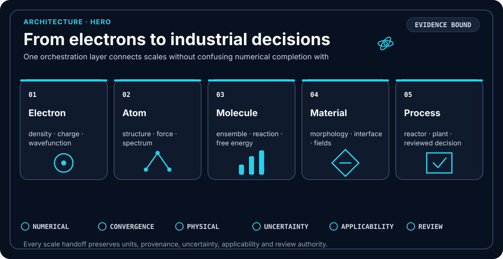

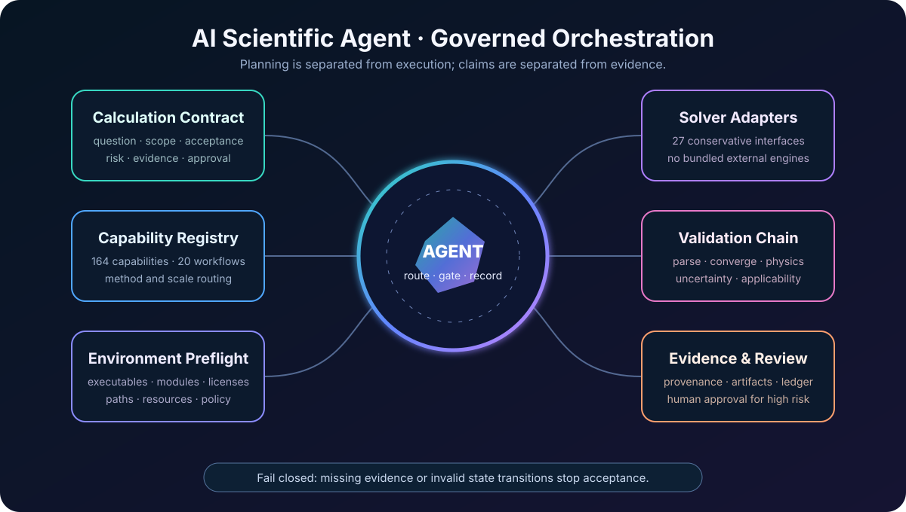

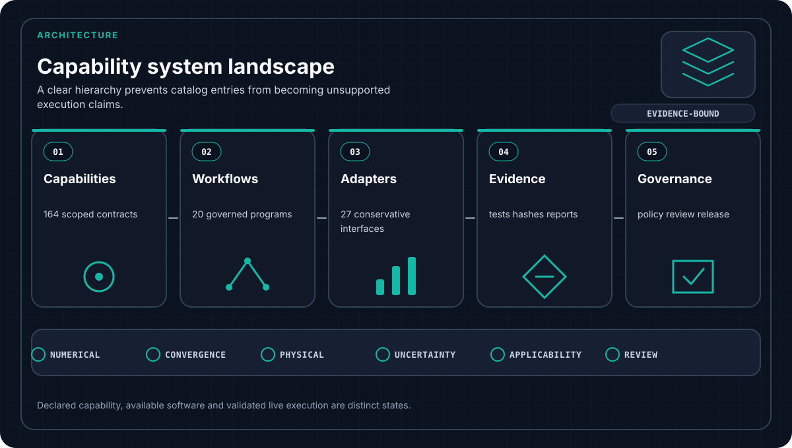

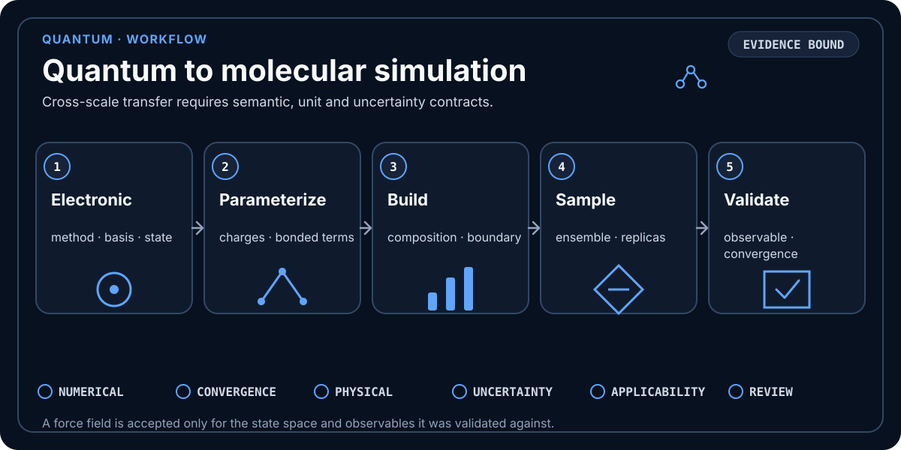

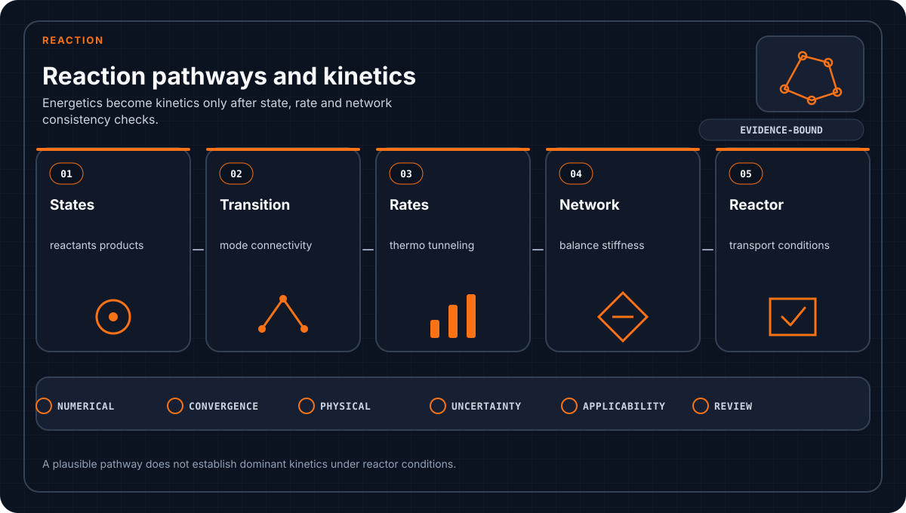

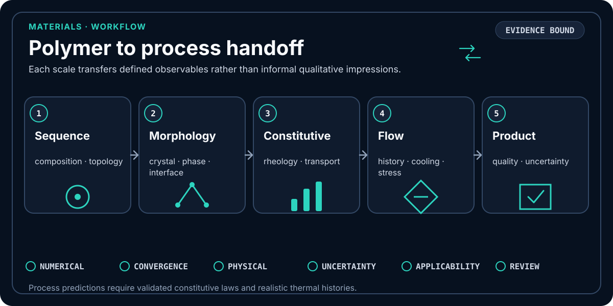

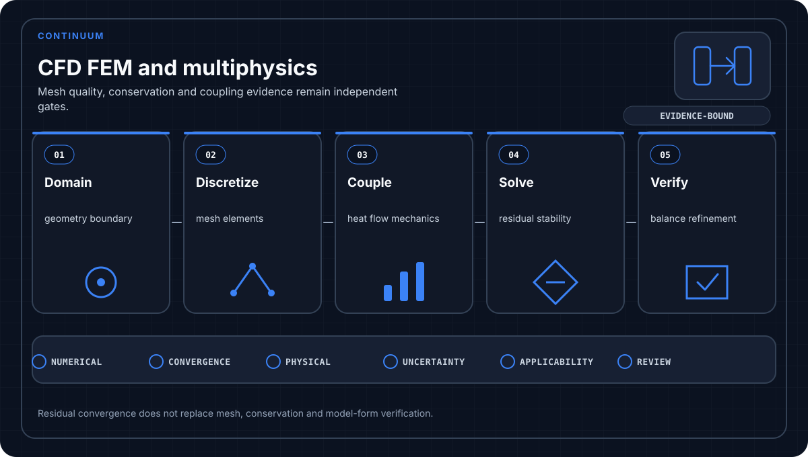

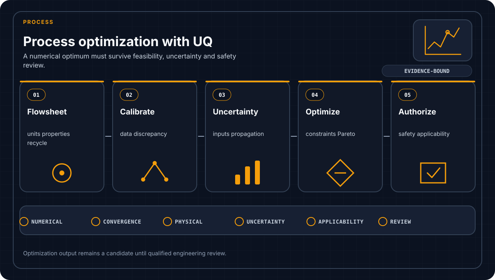

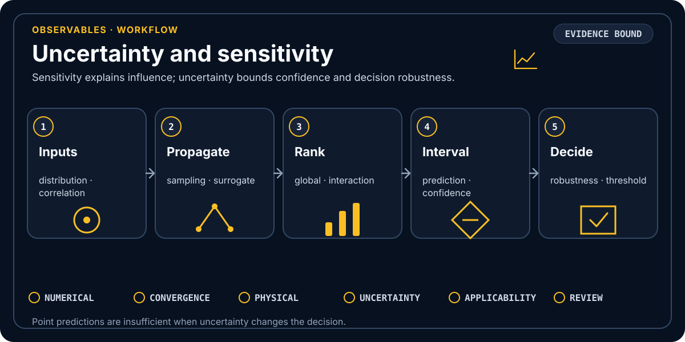

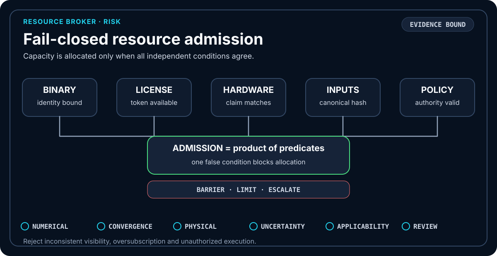

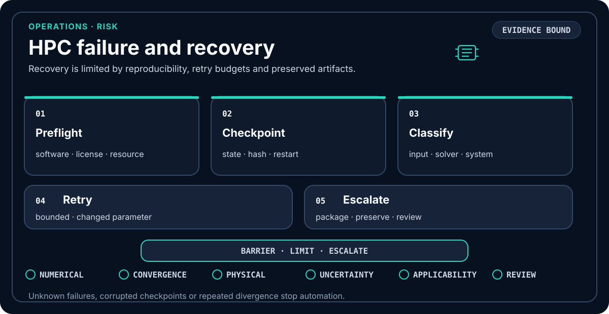

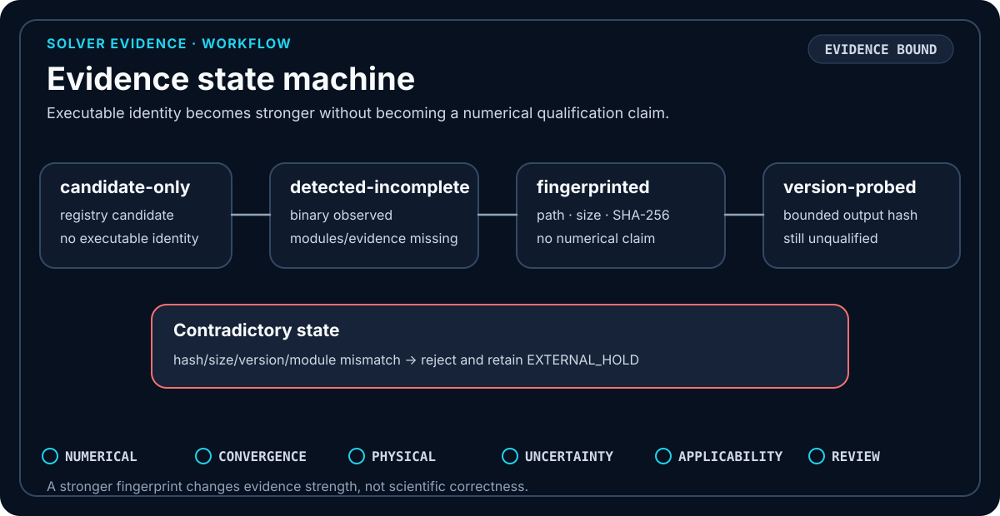
